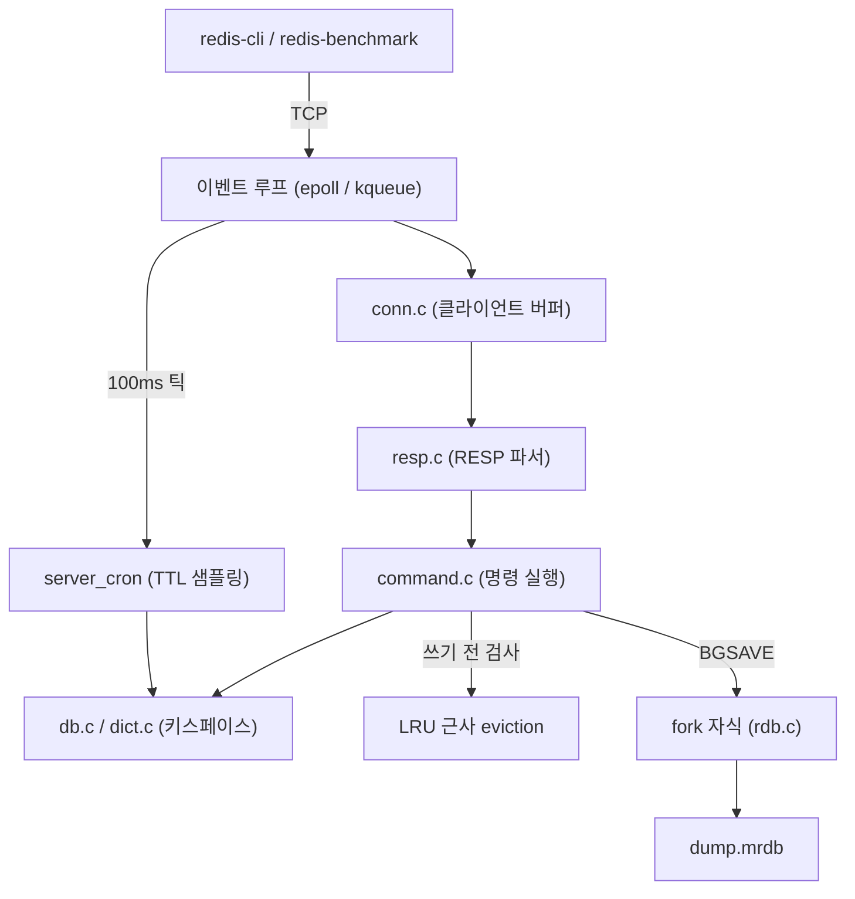
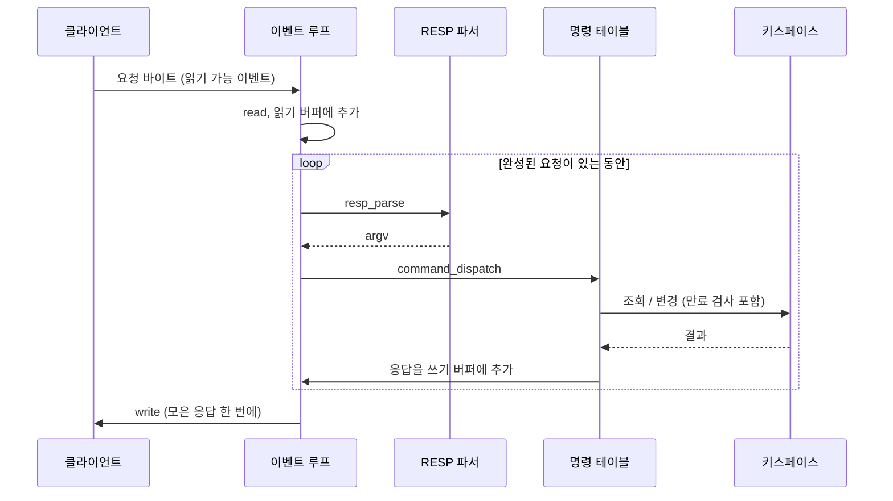

# mini-redis

C로 직접 만든 작은 Redis 서버다. 진짜 `redis-cli`와 `redis-benchmark`가 그대로 붙어서 동작한다.

## 왜 만들었나

- Redis는 캐시, 분산락, 대기열로 많이 쓰지만 안에서 어떻게 도는지는 잘 보이지 않는다.
- 직접 만들어 보며 "스레드 하나짜리 서버가 왜 빠른가", 만료(TTL)와 메모리 한도는 어떻게 처리하나, 서비스를 멈추지 않고 디스크에 저장하는 방법은 무엇인가를 체감하는 것이 목표다.
- 외부 라이브러리 없이 libc와 시스템 콜만 쓴다. Linux와 macOS에서 돈다.

## 주요 기능

- **RESP2 프로토콜** (Redis 클라이언트-서버 통신 형식): 요청이 쪼개져 오거나(부분 수신) 여러 개가 한 번에 와도(파이프라이닝) 순서대로 처리한다. telnet식 inline 명령(`PING\r\n`)도 받는다.
- **epoll / kqueue 단일 스레드 이벤트 루프**: epoll(Linux)과 kqueue(macOS)는 여러 소켓을 한 번에 감시하는 시스템 콜이다. `poller.c`가 둘을 같은 인터페이스로 감싼다. 스레드 하나가 논블로킹 소켓으로 다수 클라이언트를 처리한다.
- **자료구조**: string, list, hash, set
- **지원 명령 (30개)**: PING, ECHO, GET, SET, DEL, EXISTS, INCR, DBSIZE, FLUSHALL, LPUSH, RPUSH, LPOP, RPOP, LRANGE, LLEN, HSET, HGET, HDEL, HGETALL, SADD, SREM, SISMEMBER, SMEMBERS, SCARD, EXPIRE, TTL, PERSIST, CONFIG GET/SET (maxmemory만), SAVE, BGSAVE
- **TTL 만료**: 키에 접근할 때 검사하는 지연 삭제 + 100ms마다 만료 키를 무작위로 20개씩 뽑아 지우는 주기 샘플링 (진짜 Redis 방식)
- **maxmemory + LRU 근사 eviction**: 메모리 한도를 넘으면 무작위 샘플 중 가장 오래 안 쓴 키를 지운다. 더 지울 수 없으면 쓰기에 `-OOM` 오류를 낸다. 기본값 0은 무제한.
- **RDB 스냅샷**: `SAVE`/`BGSAVE`로 전체 데이터를 자체 바이너리 포맷 파일(`dump.mrdb`)에 저장하고, 기동 시 자동으로 읽는다. `BGSAVE`는 `fork()`로 자식 프로세스를 만들어 저장하고, COW(copy-on-write, 바뀐 메모리 페이지만 복사) 덕분에 부모는 저장 중에도 요청을 계속 받는다. 파일이 손상되면 빈 DB로 조용히 넘어가지 않고 기동을 거부한다.
- **AOF 영속화** (`--appendonly`): 상태를 바꾸는 명령을 `appendonly.aof`에 기록하고 시작할 때 재실행한다. 자세한 내용은 [AOF 영속화](#aof-영속화).
- **벤치마크**: `redis-benchmark`로 진짜 Redis(v8.8.0)와 같은 조건에서 나란히 측정했다.

## 동작 방식



1. 이벤트 루프(epoll 또는 kqueue)가 읽을 데이터가 있는 소켓을 알려주면, 서버가 그 소켓에서 읽은 바이트를 클라이언트 버퍼에 쌓는다.
2. RESP 파서가 버퍼에서 완성된 요청을 꺼내고, 명령 테이블에서 찾아 실행한다. 한 번 읽은 데이터에 요청이 여러 개면 연달아 실행한다.
3. 응답은 쓰기 버퍼에 모았다가 한 번에 `write()` 한다. 소켓이 가득 차면 쓰기 감시를 걸고 나중에 마저 보낸다.
4. 이벤트 루프는 100ms마다 깨어나 만료 키를 정리하고, 끝난 `BGSAVE` 자식 프로세스를 회수한다.

요청 하나가 처리되는 흐름:



## 벤치마크 결과

진짜 Redis v8.8.0과 같은 머신(Apple M2, 16 GiB), 같은 옵션(`-n 100000 -c 50`)으로 측정한 처리량(req/s)이다. 진짜 Redis는 영속화를 끈 상태다. 각 조건 3회 측정 중앙값.

| 명령 | mini `-P 1` | real `-P 1` | mini `-P 16` | real `-P 16` |
|------|-----------:|-----------:|------------:|------------:|
| ping  | 187,266 | 182,815 | 2,500,000 | 2,777,778 |
| set   | 176,367 | 180,832 | 2,272,727 | 1,515,152 |
| get   | 176,056 | 182,149 | 2,127,660 | 2,127,660 |
| incr  | 177,620 | 183,150 | 1,818,182 | 1,960,784 |
| lpush | 177,936 | 185,185 | 2,127,660 | 1,562,500 |
| lpop  | 176,991 | 181,488 | 2,083,333 | 1,492,537 |
| sadd  | 179,533 | 204,082 | 1,960,784 | 1,754,386 |
| hset  | 179,211 | 164,745 | 1,694,915 | 1,408,451 |

`-P`는 파이프라인 깊이(응답을 기다리지 않고 한 번에 보내는 요청 수)다.

- `-P 1`에서는 진짜 Redis와 대개 5% 이내로 비슷하다. 요청마다 왕복하므로 서버 처리보다 syscall과 네트워크 왕복 비용이 지배적이다.
- `-P 16`에서는 파이프라이닝으로 처리량이 약 10~13배 늘고, set/lpush/lpop/hset 등에서 mini-redis가 앞선다.
- 다만 앞서는 이유는 성능이 더 좋아서가 아니라 **기능이 적어서**다. 진짜 Redis가 항상 지불하는 메모리 인코딩, 다중 DB 같은 비용이 없다. 워크로드가 바뀌면 순위는 뒤집힐 수 있다.

측정 조건, p50 레이턴시, 상세 해석은 [BENCH.md](BENCH.md)에 있다.

## 빠른 시작

```bash
make
./mini-redis                 # 기본 포트 6380
./mini-redis --port 7777     # 포트 지정 (-p 7777 도 가능, 1-65535)
./mini-redis --appendonly    # AOF 영속화 (appendonly.aof)
```

다른 터미널에서:

```bash
redis-cli -p 6380 PING
redis-cli -p 6380 SET hello world
redis-cli -p 6380 GET hello
```

- 스냅샷 파일 `dump.mrdb`는 서버를 실행한 디렉터리에 생긴다.
- 메모리 한도는 런타임에 `redis-cli -p 6380 CONFIG SET maxmemory <bytes>`로 정한다.

## AOF 영속화

`--appendonly`로 켠다. 상태를 바꾸는 명령을 RESP 그대로 기록하고 시작할 때 재실행한다.

- 프로세스가 `kill -9`로 죽어도 유실이 없고, fsync는 1초 주기라 전원 장애 시 최대 약 1초분이 유실될 수 있다.
- `EXPIRE`는 절대 시각(`PEXPIREAT`)으로 기록해 재시작해도 TTL이 다시 늘어나지 않는다.
- eviction으로 지운 키는 `DEL`로 기록해 재실행 후 되살아나지 않는다.
- 쓰다 끊긴 마지막 명령은 잘라내고 경고를 남기며, 그 외 손상은 시작을 거부한다.
- AOF가 있으면 RDB보다 AOF를 우선한다. AOF rewrite(압축)는 구현하지 않았다.

## 테스트

```bash
make test
```

실제 서버를 격리된 임시 디렉터리와 포트 6399(`MINIREDIS_TEST_PORT`로 변경 가능)에 띄우고, 공식 `redis-cli`로 명령을 보내 응답을 검사하는 end-to-end 테스트다 (`tests/run.sh`). `redis-cli`와 `nc`가 필요하다.

- 검사 범위: 프로토콜(inline 포함), string, list/hash/set, TTL, 동시 접속 20개, 파이프라이닝, AOF 재실행과 손상 처리
- 결과: **55 passed, 0 failed** (macOS, Linux 컨테이너)

벤치마크 재현은 `bash bench/run_bench.sh` (`redis-benchmark`, `redis-server` 필요).

## 프로젝트 구조

```
mini-redis/
├── src/
│   ├── server.c    # main, 이벤트 루프, TTL 샘플링, BGSAVE fork
│   ├── poller.c    # epoll / kqueue 추상화
│   ├── conn.c      # 클라이언트 읽기/쓰기 버퍼
│   ├── resp.c      # RESP 파서와 응답 작성
│   ├── command.c   # 명령 테이블, maxmemory/eviction
│   ├── db.c        # 키스페이스와 만료 테이블
│   ├── dict.c      # 해시테이블
│   ├── list.c      # list 자료구조
│   ├── object.c    # 값 객체 (타입, 접근 시각)
│   ├── rdb.c       # 스냅샷 저장/로드
│   ├── aof.c       # AOF 기록과 재실행
│   └── zmalloc.c   # 할당량 추적용 malloc 래퍼
├── tests/run.sh    # end-to-end 테스트
├── bench/          # run_bench.sh, loadgen.py
├── BENCH.md        # 벤치마크 전체 결과
└── Makefile
```

## 더 보기

- [docs/SRS.md](docs/SRS.md) - 요구사항 명세
- [docs/SDS.md](docs/SDS.md) - 설계 명세: 구성도, 시퀀스, 자료구조와 파일 포맷, 모듈
- [docs/adr/](docs/adr/README.md) - 설계 결정 기록
- [CHANGELOG.md](CHANGELOG.md) - 변경 이력
- [BENCH.md](BENCH.md) - 벤치마크 측정 조건, 전체 수치, 해석
- [.planning/SPEC.md](.planning/SPEC.md) - 요구사항과 수용 기준
- [.planning/plans/](.planning/plans/) - 단계별 구현 계획
