# mini-redis 소프트웨어 설계 명세서 (SDS)

| 문서 | 버전 | 작성일 | 기준 표준 |
|------|------|--------|-----------|
| mini-redis SDS | 1.0 | 2026-11-18 | IEEE 1016-2009 |

## 1. 소개

### 1.1 목적

이 문서는 mini-redis의 설계를 설명한다. 요구사항([SRS](SRS.md))이 코드의 어느 구성 요소, 자료구조, 흐름으로 구현되는지 보여 준다.

### 1.2 범위

C11(GNU 확장)로 만든 Linux와 macOS용 단일 노드 Redis 호환 서버 하나를 다룬다. 프로세스는 단일 스레드 이벤트 루프 하나(Linux epoll, macOS kqueue를 `poller.c`로 감쌈)와, `BGSAVE` 때만 생기는 fork 자식 프로세스로 이루어진다. `--appendonly`면 AOF 파일에 쓰기 명령을 덧붙인다. 외부 라이브러리는 없다.

### 1.3 용어 정의

[SRS 1.4 용어 정의](SRS.md#14-용어-정의)를 따른다. 이 문서에서 추가로 쓰는 용어는 다음과 같다.

| 용어 | 뜻 |
|------|----|
| 키스페이스 | 키 -> 값 객체를 담은 해시테이블 (`redisDb.dict`) |
| 만료 테이블 | 키 -> 만료 절대 시각(ms)을 담은 별도 해시테이블 (`redisDb.expires`) |
| `robj` | 값 객체. 타입 태그, 실제 값 포인터, 마지막 접근 시각을 가진다 |
| `sstr` | 길이를 함께 저장하는 이진 안전 문자열 |
| arity | 명령 이름을 포함한 인자 개수 규칙. 양수는 정확히 그 개수, 음수는 "최소 \|arity\|개" |
| FNV-1a | 바이트마다 XOR 후 곱하는 64비트 해시 함수. 해시테이블 인덱스와 스냅샷 체크섬에 쓴다 |
| 쓰기 감시 | 소켓이 쓰기 가능해질 때 알림을 받도록 poller에 등록하는 것. epoll은 `EPOLLOUT`, kqueue는 `EVFILT_WRITE` |
| 끊긴 꼬리 | AOF를 쓰다가 프로세스가 죽어 파일 끝에 남은 불완전한 명령 |

### 1.4 참고 문서

| 문서 | 내용 |
|------|------|
| [SRS.md](SRS.md) | 요구사항 명세 (FR, NFR, 추적표) |
| [README.md](../README.md) | 프로젝트 소개와 빠른 시작 |
| [BENCH.md](../BENCH.md) | 벤치마크 측정 조건, 수치, 해석 |
| [.planning/SPEC.md](../.planning/SPEC.md) | 원본 요구사항 |
| [.github/workflows/ci.yml](../.github/workflows/ci.yml) | Linux와 macOS CI |

## 2. 설계 이해관계자와 관심사

| 이해관계자 | 관심사 | 다루는 뷰 |
|------------|--------|-----------|
| 학습자 / 개발자 | 단일 스레드로 다수 클라이언트를 처리하는 방법, epoll/kqueue 추상화, 파이프라이닝, TTL과 LRU 근사, fork + COW 저장, AOF 기록과 재실행 | 3.2 구성, 3.6 상호작용, 3.7 상태, 3.8 알고리즘 |
| 코드 리뷰어 | 모듈 경계, 자료구조 소유 관계, 오류 처리 | 3.2 구성, 3.3 논리, 5 오류 처리 |
| 클라이언트 도구 사용자 | 지원 명령, 응답 형식, 기동 옵션 | 3.1 컨텍스트, 3.5 인터페이스 |
| 스냅샷/AOF 파일을 다루는 사람 | `dump.mrdb` 바이트 배치, `appendonly.aof` 형식, 손상 판정 기준, 둘 중 무엇을 로드하는지 | 3.4 정보, 3.6 AOF 재실행, 5 오류 처리 |
| 운영 / 벤치 수행자 | 포트, 파일, 타이머, 버퍼 상한, fsync 주기, 플랫폼 | 3.9 자원 |

## 3. 설계 뷰

### 3.1 컨텍스트 뷰

mini-redis를 하나의 블랙박스로 보면, 바깥에는 TCP 클라이언트와 현재 디렉터리의 스냅샷 파일, AOF 파일(`--appendonly`일 때)만 있다.

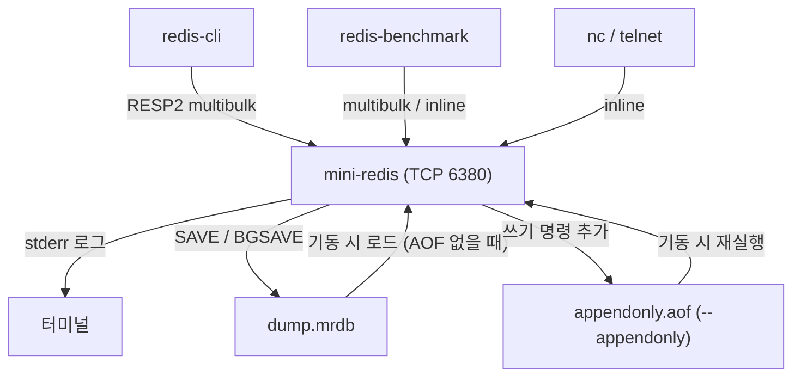

| 외부 요소 | 관계 |
|-----------|------|
| `redis-cli` | 명령을 multibulk로 보내고 응답을 표시한다 |
| `redis-benchmark` | 부하를 건다. PING_INLINE 테스트는 inline 형식을 쓴다 |
| `nc` / telnet | `PING\r\n` 같은 한 줄 inline 명령을 보낸다 (`tests/run.sh`가 사용) |
| `dump.mrdb` | 현재 디렉터리의 스냅샷 파일. 기동 시 읽고 `SAVE`/`BGSAVE` 때 쓴다 |
| `appendonly.aof` | `--appendonly`일 때 현재 디렉터리의 AOF 파일. 기동 시 재실행하고, 이후 쓰기 명령을 덧붙인다 |
| 터미널 (stderr) | 기동, 로드, 손상, AOF 꼬리 잘라냄 경고, `BGSAVE` 결과 로그 |

### 3.2 구성 뷰

요청 경로 - 소켓에서 명령 테이블까지:

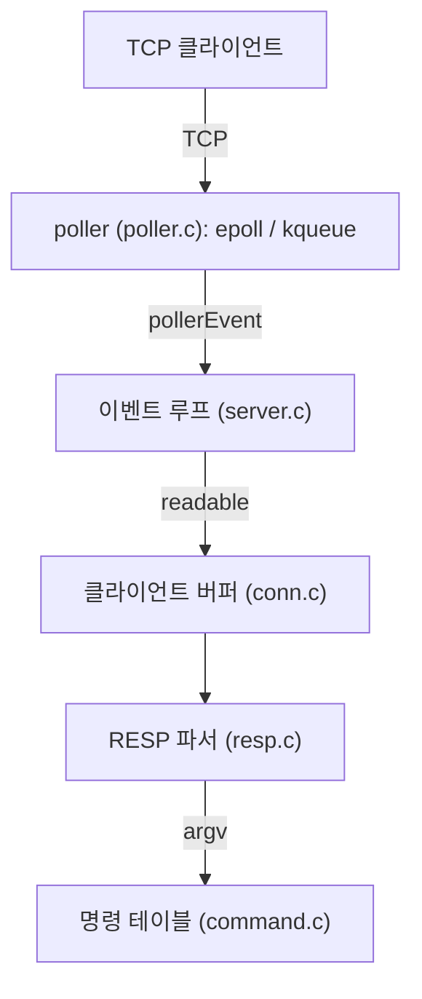

명령 실행 이후와 백그라운드 경로 - 키스페이스, 만료, eviction, BGSAVE, AOF:

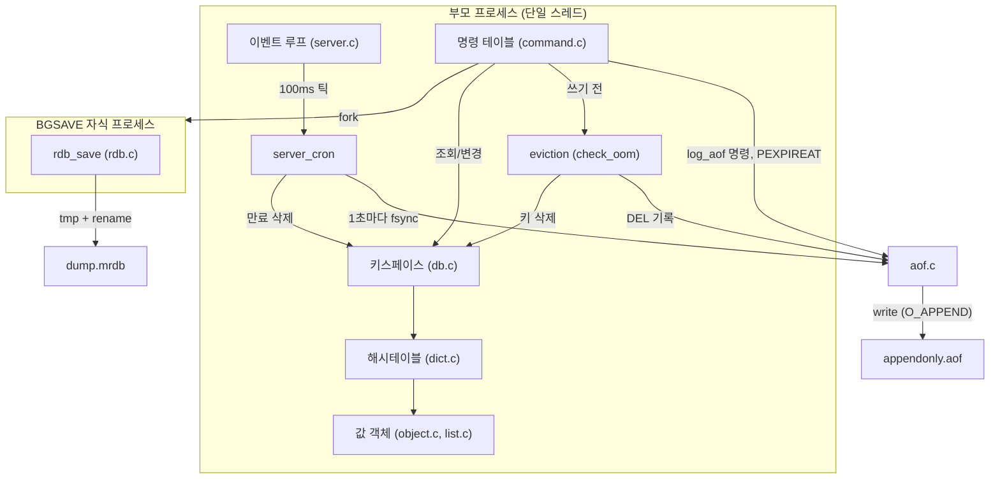

모든 할당은 `zmalloc.c` 래퍼를 지난다 (그림에서는 생략). 기동 시 `--appendonly`면 `aof_load`가 `appendonly.aof`를 재실행하고, AOF가 없을 때만 `rdb_load`가 `dump.mrdb`를 읽어 키스페이스를 채운다.

| 구성 요소 | 역할 | 기술 |
|-----------|------|------|
| 이벤트 루프 (`server.c`) | 리스닝 소켓 accept, 클라이언트 읽기/쓰기 이벤트 분배, 100ms 틱, `BGSAVE` fork와 자식 회수, 기동 시 AOF/RDB 로드 순서 결정 | `poller_*`, 논블로킹 소켓, `fork`, `waitpid` |
| poller (`poller.c`) | 플랫폼 멀티플렉싱 API를 같은 인터페이스로 감쌈. 두 쪽 모두 level-triggered | Linux epoll (`epoll_create1`, `epoll_ctl`, `epoll_wait`), macOS kqueue (`kqueue`, `kevent`). `__linux__`로 컴파일 시 선택 |
| 클라이언트 버퍼 (`conn.c`) | 클라이언트별 읽기/쓰기 버퍼와 파싱된 argv 보관 | 2배씩 늘어나는 동적 버퍼 |
| RESP 파서 (`resp.c`) | 읽기 버퍼에서 완성된 요청 하나를 argv로 꺼내고, 응답을 RESP로 인코딩 | incremental multibulk 파서, inline 파서 |
| 명령 테이블 (`command.c`) | 이름으로 핸들러 찾기, arity 검사, 메모리 검사 후 실행 | 정적 배열 `command_table`, 대소문자 무시 비교 |
| eviction (`command.c`) | maxmemory 초과 시 LRU 근사로 키 삭제, 실패 시 `-OOM` | 무작위 샘플 5개 |
| `server_cron` (`server.c`) | 자식 회수, 만료 키 주기 샘플링, AOF fsync | `poller_wait` 타임아웃 100ms |
| 키스페이스 (`db.c`) | 키스페이스와 만료 테이블 관리, 지연 삭제, 접근 시각 갱신 | dict 2개 |
| 해시테이블 (`dict.c`) | 키 -> 값 저장, 무작위 항목 뽑기, 순회 | 체이닝, FNV-1a, 2의 거듭제곱 버킷 |
| 값 객체 (`object.c`, `list.c`) | string/list/hash/set 값 표현 | `robj`, `sstr`, 이중 연결 리스트 |
| 스냅샷 (`rdb.c`) | 키스페이스 직렬화/역직렬화, 체크섬 검증 | 자체 바이너리 포맷, FNV-1a 64 체크섬 |
| AOF (`aof.c`) | 쓰기 명령을 RESP로 덧붙임, 1초 주기 fsync, 기동 시 재실행과 끊긴 꼬리 잘라내기 | `O_APPEND` 파일, `fsync`, `truncate`, RESP 파서와 명령 테이블 재사용 |
| 메모리 추적 (`zmalloc.c`) | 살아 있는 할당 바이트 합계 유지 | macOS `malloc_size()`, Linux `malloc_usable_size()` |

### 3.3 논리 뷰

값 객체의 소유 관계는 다음과 같다. 화살표는 "가리키고 해제 책임을 진다"는 뜻이다.

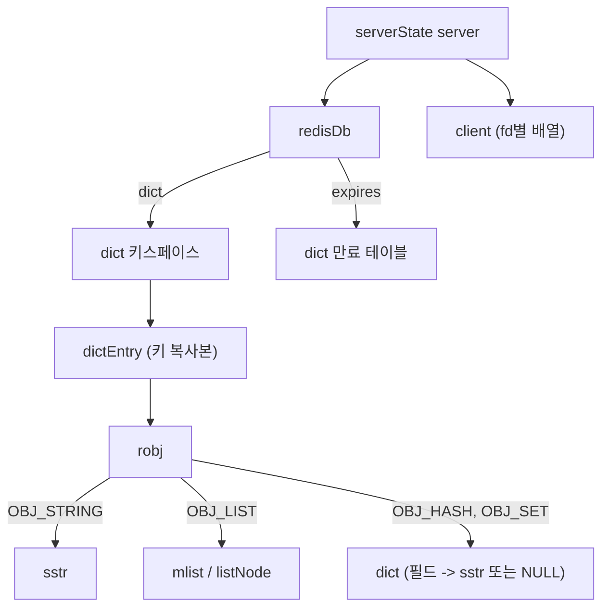

| 구조체 | 필드 | 설명 |
|--------|------|------|
| `serverState` (`server.h`) | `int poller` | poller fd (epoll 또는 kqueue) |
| | `int port`, `int listen_fd` | 리슨 포트 (기본 `SERVER_PORT` 6380)와 리스닝 소켓 |
| | `client **clients`, `int clients_cap` | fd를 인덱스로 쓰는 클라이언트 배열. 처음 64칸, 2배씩 확장 |
| | `redisDb *db` | 유일한 데이터베이스 |
| | `long long maxmemory` | 메모리 상한 바이트. 0이면 eviction 끔 |
| | `long long last_cron` | 마지막 주기 작업 시각 (ms) |
| | `pid_t rdb_child_pid` | 진행 중인 `BGSAVE` 자식 pid. 없으면 -1 |
| | `const char *rdb_filename` | `"dump.mrdb"` |
| | `int aof_enabled` | `--appendonly`면 1 |
| | `int aof_fd` | AOF 파일 fd. AOF를 끄면 -1 |
| | `int aof_loading` | 재실행 중이면 1. 이때는 명령을 다시 기록하지 않는다 |
| | `const char *aof_filename` | `"appendonly.aof"` |
| `client` (`conn.h`) | `int fd` | 클라이언트 소켓 |
| | `char *rbuf`, `size_t rlen`, `size_t rcap` | 아직 파싱하지 않은 수신 바이트 |
| | `char *wbuf`, `size_t wlen`, `size_t wsent`, `size_t wcap` | 보낼 응답 바이트와 이미 보낸 양 |
| | `int write_blocked` | 쓰기 감시 등록 여부 |
| | `int flags` | `CLIENT_CLOSE_AFTER_WRITE` (1): 응답을 다 보낸 뒤 연결 종료 |
| | `arg *argv`, `int argc`, `int argv_cap` | 현재 실행할 명령의 인자 |
| `arg` (`conn.h`) | `char *data`, `size_t len` | 이진 안전 인자 하나 |
| `redisDb` (`db.h`) | `dict *dict` | 키 -> `robj*` |
| | `dict *expires` | 키 -> 만료 절대 시각 ms. 값을 포인터 자리에 정수로 직접 저장 (`intptr_t`) |
| `dict` (`dict.h`) | `dictEntry **table` | 버킷 배열 |
| | `size_t size`, `size_t mask` | 버킷 수 (2의 거듭제곱, 처음 16)와 `size - 1` |
| | `size_t used` | 항목 수 |
| | `dictValFree valfree` | 값 해제 함수. 키스페이스는 `obj_free`, hash는 `zfree`, set과 만료 테이블은 NULL |
| `dictEntry` (`dict.h`) | `char *key`, `size_t klen` | 키 복사본 |
| | `void *val` | 값 포인터 |
| | `dictEntry *next` | 같은 버킷의 다음 항목 (체이닝) |
| `dictIterator` (`dict.h`) | `dict *d`, `size_t idx`, `dictEntry *entry`, `dictEntry *next` | 순회 상태. `next`를 미리 잡아 두어 순회 중 현재 항목 삭제 가능 |
| `robj` (`object.h`) | `obj_type type` | `OBJ_STRING`(0), `OBJ_LIST`(1), `OBJ_HASH`(2), `OBJ_SET`(3) |
| | `void *ptr` | `sstr*`, `mlist*`, 또는 `dict*` |
| | `long long lru` | 마지막 접근 시각 (ms). 생성 시 0, `db_lookup` 때 갱신 |
| `sstr` (`object.h`) | `size_t len`, `char data[]` | 길이 + 바이트 (끝에 편의용 NUL) |
| `mlist` (`list.h`) | `listNode *head`, `listNode *tail`, `size_t len` | 이중 연결 리스트 |
| `listNode` (`list.h`) | `sstr *value`, `listNode *prev`, `listNode *next` | 리스트 요소 |
| `command` (`command.c`) | `const char *name`, `cmd_handler handler` | 명령 이름과 핸들러 |
| | `int arity` | 인자 개수 규칙 |
| | `int deny_oom` | 1이면 실행 전 메모리 검사 (SET, INCR, LPUSH, RPUSH, HSET, SADD) |
| | `int log_aof` | 1이면 실행 전 AOF에 기록 (SET, DEL, INCR, FLUSHALL, LPUSH, RPUSH, LPOP, RPOP, HSET, HDEL, SADD, SREM, PERSIST, PEXPIREAT). `EXPIRE`는 0이고 핸들러가 `PEXPIREAT`로 따로 기록 |
| `pollerEvent` (`poller.h`) | `int fd`, `int readable`, `int writable` | 플랫폼 이벤트를 옮긴 것. epoll은 한 이벤트에 두 플래그가 같이 올 수 있고, `EPOLLHUP`/`EPOLLERR`는 readable로 올린다 |

### 3.4 정보 뷰

#### 값 타입별 표현

| 타입 | `robj.ptr` | 내부 표현 | 비면 |
|------|------------|-----------|------|
| string | `sstr*` | 길이 + 바이트 | - |
| list | `mlist*` | `listNode` 이중 연결 리스트, 요소는 `sstr*` | 키 삭제 (`LPOP`/`RPOP`) |
| hash | `dict*` | 필드 -> `sstr*` 값 | 키 삭제 (`HDEL`) |
| set | `dict*` | 멤버 -> NULL | 키 삭제 (`SREM`) |

#### 메모리 계산

- `zmalloc`/`zcalloc`/`zrealloc`/`zfree`가 실제 블록 크기(macOS `malloc_size()`, Linux `malloc_usable_size()`)를 더하고 빼서 `used_memory`를 유지한다. 클라이언트 버퍼와 argv도 포함한다.
- 쓰기 전 예상 증가량 `incoming_bytes`는 `argv[2]`부터 각 인자의 `길이 + 64`를 더한 값이다.

#### RESP2 요청 형식

| 형식 | 바이트 | 예 |
|------|--------|----|
| multibulk | `*<개수>\r\n` 뒤에 인자마다 `$<길이>\r\n<바이트>\r\n` | `*2\r\n$3\r\nGET\r\n$1\r\nk\r\n` |
| inline | 첫 바이트가 `*`가 아닌 한 줄. 공백/탭으로 나누고 `\n` (앞의 `\r`은 선택)으로 끝 | `PING\r\n` |

| 상한 | 값 | 넘으면 |
|------|----|--------|
| 인자 개수 (`RESP_MAX_MULTIBULK`) | 1,048,576 | Protocol error |
| bulk 하나 길이 (`RESP_MAX_BULK_LEN`) | 512MB | Protocol error |
| `*`/`$` 헤더 줄 (CRLF 없이) | 64바이트 | Protocol error |
| inline 한 줄 (`RESP_MAX_INLINE`) | 64KiB | Protocol error |

#### RESP2 응답 형식

| 함수 (`resp.c`) | 바이트 | 쓰임 |
|-----------------|--------|------|
| `reply_simple` | `+<문자열>\r\n` | `OK`, `PONG`, `Background saving started` |
| `reply_error` | `-<문자열>\r\n` | `ERR ...`, `WRONGTYPE ...`, `OOM ...` |
| `reply_integer` | `:<정수>\r\n` | `DEL`, `INCR`, `TTL` 등 |
| `reply_bulk` | `$<길이>\r\n<바이트>\r\n` | `GET`, `LPOP`, `HGET` 등 |
| `reply_null` | `$-1\r\n` | 없는 키 (nil) |
| `reply_array_header` | `*<개수>\r\n` 뒤에 요소 | `LRANGE`, `HGETALL`, `SMEMBERS`, `CONFIG GET` |

#### 스냅샷 파일 `dump.mrdb`

모든 정수는 little-endian이다. 문자열(`str`)은 `u32 길이 + 바이트`다.

| 순서 | 필드 | 크기 | 값 |
|------|------|------|----|
| 1 | 매직 | 4바이트 | `MRDB` |
| 2 | 버전 | `u8` | 1 |
| 3 | 레코드 | 가변, 0개 이상 반복 | 아래 레코드 표 |
| 4 | 끝 마커 | `u8` | `0xFF` |
| 5 | 체크섬 | `u64` | 매직부터 끝 마커까지 모든 바이트의 FNV-1a 64 (초깃값 1469598103934665603, 곱수 1099511628211) |

레코드:

| 순서 | 필드 | 크기 | 값 |
|------|------|------|----|
| 1 | opcode | `u8` | `0x01` |
| 2 | 만료 유무 | `u8` | 0 또는 1 |
| 3 | 만료 시각 | `u64` | 절대 시각 ms. 만료 유무가 1일 때만 존재 |
| 4 | 타입 | `u8` | 0 string, 1 list, 2 hash, 3 set |
| 5 | 키 | `str` | |
| 6 | 페이로드 | 타입별 | 아래 표 |

| 타입 | 페이로드 |
|------|----------|
| string | `str` |
| list | `u32 개수` + 머리부터 `str` 반복 |
| set | `u32 개수` + 멤버 `str` 반복 |
| hash | `u32 개수` + (`str` 필드, `str` 값) 반복 |

- 저장은 `dump.mrdb.tmp-<pid>`에 쓴 뒤 `rename()`으로 교체한다. 실패하면 임시 파일을 지운다.
- 어떤 길이 필드든 512MB(`RDB_MAX_LEN`)를 넘으면 손상으로 본다.
- 접근 시각(`lru`)은 저장하지 않는다.

#### AOF 파일 `appendonly.aof`

헤더, 버전, 체크섬이 없다. 명령마다 RESP2 multibulk 하나를 순서대로 덧붙인 바이트열이다. 인자는 이진 안전하게 길이와 함께 쓴다.

| 순서 | 필드 | 바이트 | 예 (`SET s hello`) |
|------|------|--------|--------------------|
| 1 | 인자 개수 | `*<argc>\r\n` | `*3\r\n` |
| 2 | 인자마다 길이 | `$<len>\r\n` | `$3\r\n` |
| 3 | 인자마다 데이터 + CRLF | `<len 바이트>\r\n` | `SET\r\n` |

| 무엇이 기록되나 | 기록 형태 | 위치 |
|-----------------|-----------|------|
| `log_aof`가 1인 명령 | 받은 argv 그대로 | `command_dispatch` (arity, OOM 검사 통과 후, 핸들러 실행 전) |
| `EXPIRE key secs` (키가 있을 때) | `PEXPIREAT key <절대 ms>`. secs가 0 이하면 `PEXPIREAT key 0` | `expire_cmd` (`aof_log_deadline`) |
| eviction으로 지운 키 | `DEL key` | `evict_until` |
| 재실행 중 실행한 명령 | 기록하지 않음 (`aof_loading`) | `command_dispatch`, `aof_log_deadline`, `evict_until` |

- 파일은 `O_WRONLY | O_CREAT | O_APPEND | O_CLOEXEC`, 권한 0644로 연다.
- 첫 바이트가 `*`가 아닌 명령, RESP 파싱 오류, 재실행 응답이 `-ERR`로 시작하면 손상이다.
- 파일 끝의 불완전한 명령(끊긴 꼬리)은 손상이 아니라 잘라낸다.
- rewrite(압축)가 없어 파일은 계속 커진다.

### 3.5 인터페이스 뷰

#### 명령행

| 사용법 | 동작 |
|--------|------|
| `./mini-redis` | 포트 6380에서 기동. 현재 디렉터리의 `dump.mrdb`가 있으면 로드 |
| `./mini-redis --port N` / `-p N` | 포트 N(1-65535)에서 기동 |
| `./mini-redis --appendonly` | AOF 영속화를 켠다. `appendonly.aof`가 있으면 재실행하고 `Loaded N keys from appendonly.aof` 로그. 없으면 `dump.mrdb`를 로드 |
| 손상된 `appendonly.aof` | `FATAL: AOF file 'appendonly.aof' is corrupt; refusing to start` 후 종료 코드 1 |
| 끊긴 꼬리가 있는 `appendonly.aof` | `WARNING: cutting N bytes of a partial last command from appendonly.aof` 후 잘라내고 기동 |
| 잘못된 인자 / 범위 밖 포트 | stderr에 `error: ...` 출력 후 종료 코드 1 |
| 손상된 `dump.mrdb` | `FATAL: RDB file 'dump.mrdb' is corrupt or truncated; refusing to start` 후 종료 코드 1 |
| `bind`/`listen`/poller 생성/AOF 열기 실패 | `perror` 출력 후 종료 코드 1 |

#### 빌드와 실행 도구

| 명령 | 동작 |
|------|------|
| `make` | `src/*.c`를 `cc -std=gnu11 -Wall -Wextra -O2`로 빌드해 `mini-redis` 생성 |
| `make test` | 빌드 후 `tests/run.sh` 실행. 45개 검사 (AOF 검사는 포트 +1의 별도 서버) |
| CI (`.github/workflows/ci.yml`) | push와 pull request마다 `ubuntu-latest`, `macos-latest`에서 `redis-cli`를 설치하고 `make test` |
| `make clean` | `mini-redis` 삭제 |
| `bash bench/run_bench.sh` | mini-redis(6380)와 진짜 Redis(6379)를 같은 옵션으로 측정 |
| `python3 bench/loadgen.py [-n N] [-c C] [-P P] [-p PORT]` | mini-redis 단독 대체 부하 |

#### 명령 (RESP)

arity는 명령 이름을 포함한 인자 개수다. 음수는 "최소 그 개수"다.

| 명령 | arity | 응답 |
|------|-------|------|
| `PING [msg]` | -1 | `+PONG` 또는 msg bulk |
| `ECHO msg` | 2 | bulk |
| `GET key` | 2 | bulk 또는 nil |
| `SET key value` | 3 | `+OK`. 기존 타입과 TTL을 지우고 덮어씀 |
| `DEL key...` | -2 | 지운 키 개수 |
| `EXISTS key...` | -2 | 존재하는 키 개수 |
| `INCR key` | 2 | 증가한 값. TTL 유지 |
| `DBSIZE` | 1 | 키 개수 |
| `FLUSHALL` | 1 | `+OK` |
| `LPUSH` / `RPUSH key v...` | -3 | 리스트 길이 |
| `LPOP` / `RPOP key` | 2 | bulk 또는 nil |
| `LRANGE key start stop` | 4 | 배열. 음수 인덱스는 끝에서부터 |
| `LLEN key` | 2 | 길이 |
| `HSET key f v [f v...]` | -4 (짝수 개) | 새로 추가된 필드 수 |
| `HGET key f` | 3 | bulk 또는 nil |
| `HDEL key f...` | -3 | 지운 필드 수 |
| `HGETALL key` | 2 | 필드, 값 번갈아 배열 (순서 미지정) |
| `SADD key m...` | -3 | 새로 추가된 멤버 수 |
| `SREM key m...` | -3 | 지운 멤버 수 |
| `SISMEMBER key m` | 3 | 0 또는 1 |
| `SMEMBERS key` | 2 | 배열 (순서 미지정) |
| `SCARD key` | 2 | 멤버 수 |
| `EXPIRE key seconds` | 3 | 1 (설정/삭제) 또는 0 (키 없음) |
| `TTL key` | 2 | 남은 초 (올림), -1 만료 없음, -2 키 없음 |
| `PERSIST key` | 2 | 만료를 지웠으면 1, 아니면 0 |
| `PEXPIREAT key ms` | 3 | 키 없으면 0. 절대 시각(ms)이 지났으면 키 삭제, 아니면 만료 설정 후 1. 정수가 아니면 `-ERR value is not an integer or out of range` |
| `CONFIG GET maxmemory` | -2 | `["maxmemory", "<값>"]` |
| `CONFIG SET maxmemory <bytes>` | -2 | `+OK`. 단위 `b`, `k`, `kb`, `m`, `mb`, `g`, `gb` (대소문자 무시) |
| `SAVE` | 1 | `+OK` 또는 `-ERR error saving DB on disk` |
| `BGSAVE` | -1 | `+Background saving started` 또는 `-ERR` |

### 3.6 상호작용 뷰

#### 요청 처리 (read -> parse -> execute -> reply)

한 번의 읽기 이벤트에서 버퍼에 쌓인 요청을 모두 순서대로 실행하고, 응답을 모아 한 번에 쓴다. 소켓이 가득 차면 쓰기 감시를 걸고 나중에 이어 쓴다.

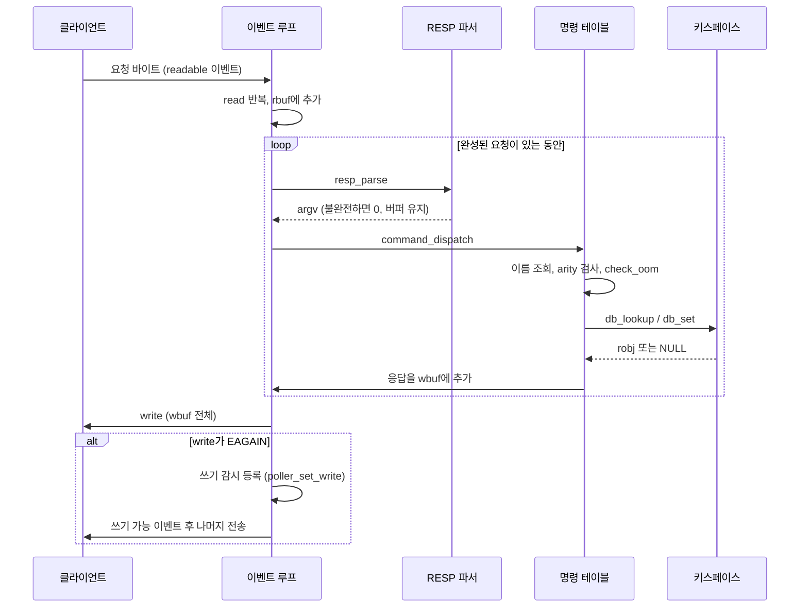

#### TTL 만료 (지연 삭제 + 주기 샘플링)

모든 명령의 키 조회는 `db.c`의 `lookup` 한 곳을 지나므로 만료 키가 값으로 보이지 않는다. 접근이 없는 키는 100ms 틱의 샘플링이 지운다.

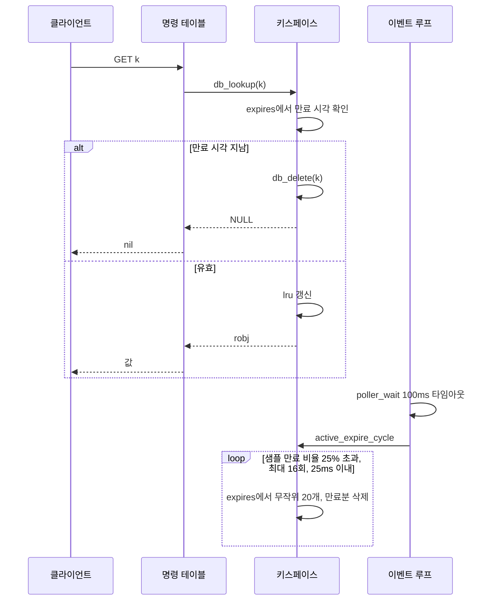

#### 쓰기 전 eviction (실패 경로 포함)

`deny_oom` 명령만 검사한다. maxmemory가 0이면 바로 실행한다.

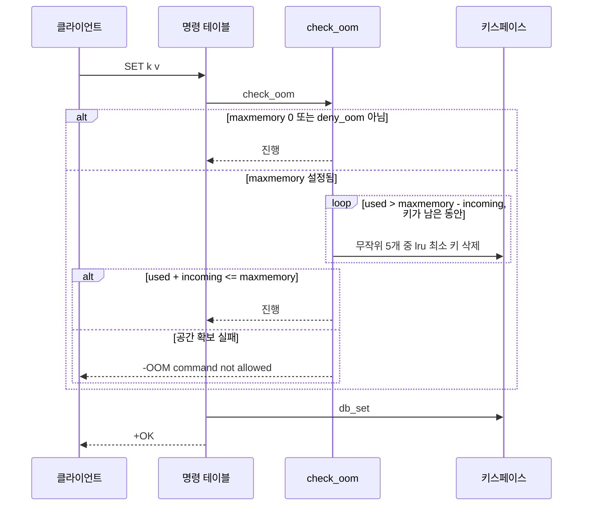

#### BGSAVE (fork + COW, 실패 경로 포함)

부모는 fork 직후 응답하고 요청 처리를 계속한다. 자식은 fork 시점의 메모리를 그대로 보고 저장한다.

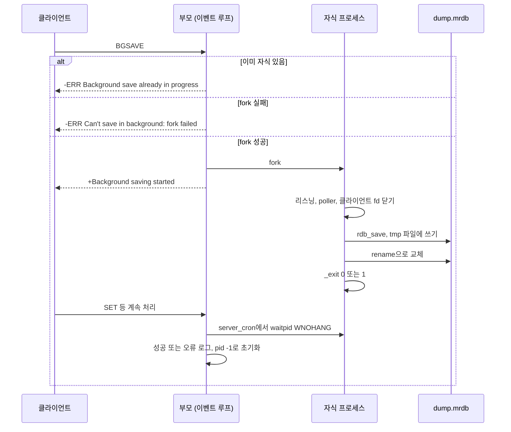

#### AOF 기록 (`--appendonly`)

명령은 핸들러 실행 전에 기록되고, fsync는 `server_cron`에서 1초에 한 번이다.

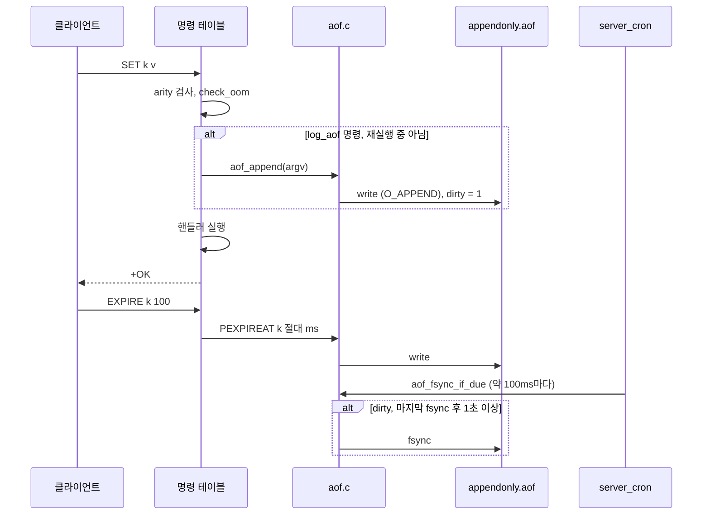

`write()`가 실패하면 기록하지 못한 쓰기를 성공으로 응답하지 않도록 `FATAL: AOF write failed` 후 종료 코드 1로 프로세스를 끝낸다.

#### 기동 시 로드 (AOF 재실행, 실패 경로 포함)

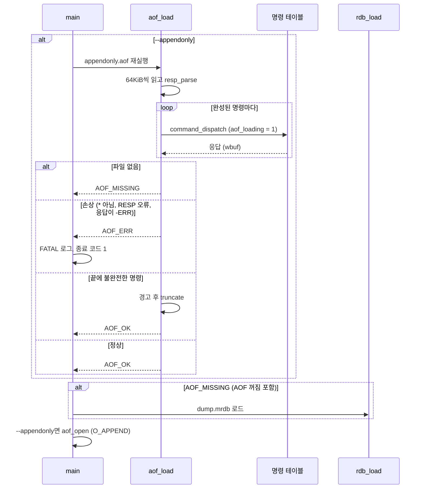

AOF가 로드되면(`AOF_OK`) `dump.mrdb`는 읽지 않는다. AOF에 전체 이력이 있으므로 그 위에 스냅샷을 다시 올리면 지운 키가 되살아나기 때문이다 (코드 주석).

### 3.7 상태 동적 뷰

#### 클라이언트 연결

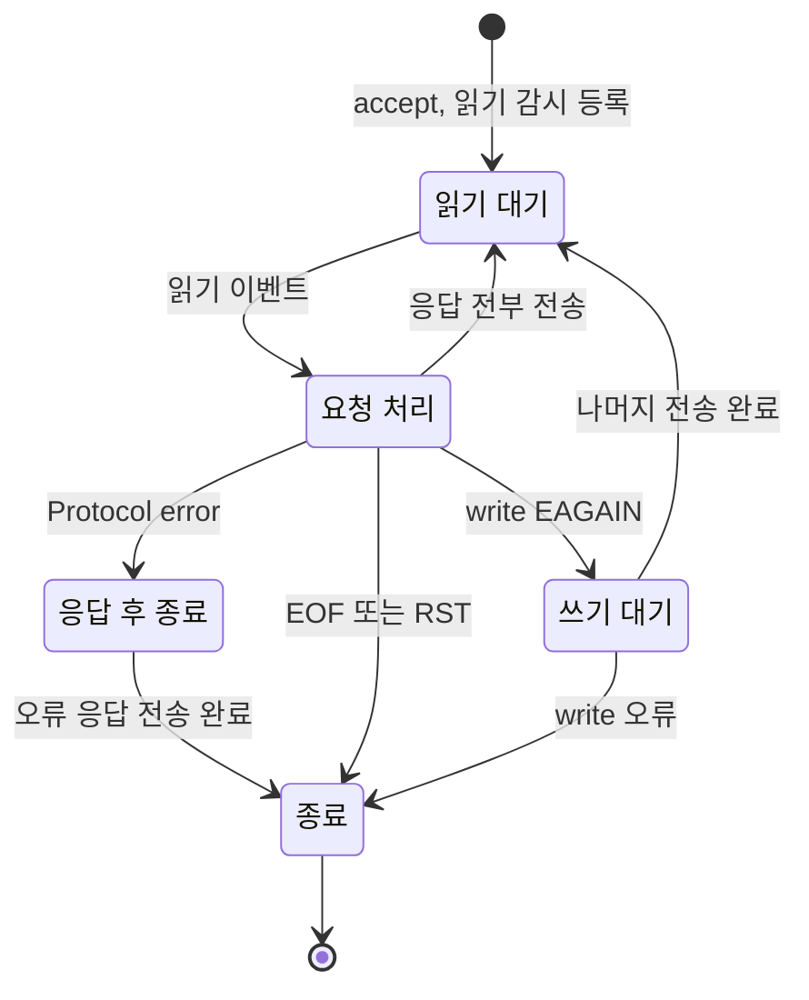

종료 시 `close_client`가 `poller_del`로 감시 등록을 지우고, 버퍼와 argv를 해제하고, fd를 닫는다. epoll은 한 이벤트에 읽기와 쓰기가 같이 올 수 있어, 읽기 처리 뒤 클라이언트가 아직 있는지 다시 확인한 다음 쓰기를 처리한다.

#### BGSAVE 자식

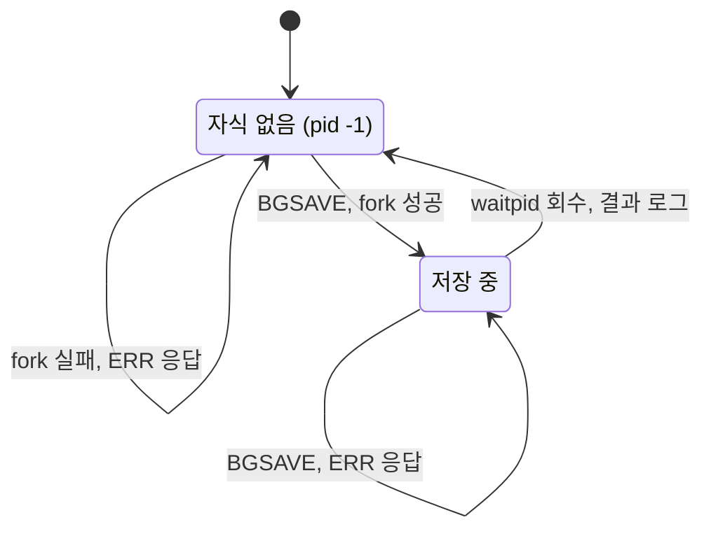

### 3.8 알고리즘 뷰

#### incremental RESP 파싱 (`resp_parse`)

```
if rbuf 비어 있음: return 0 (더 필요)
if 첫 바이트 != '*': return resp_parse_inline
줄 끝(CRLF)이 없으면: 64바이트 넘으면 -1, 아니면 0
count 파싱. 0이면 소비 후 argc=0으로 1 반환. 음수 또는 상한 초과면 -1
for 각 인자:
    '$' 아니면 -1
    길이 줄이 아직 없으면 0 (64바이트 넘으면 -1)
    데이터 + CRLF가 아직 다 안 왔으면 0
    임시 배열에 복사
모두 성공하면 argv에 커밋하고 소비한 바이트만큼 rbuf를 앞으로 당김
불완전(0)이나 오류(-1)면 임시 할당만 해제하고 rbuf는 그대로 둠
```

rbuf를 커밋 전까지 건드리지 않으므로, 바이트가 하나씩 와도 같은 지점부터 다시 파싱하면 된다. 호출자는 0이 나올 때까지 반복해 파이프라이닝된 요청을 모두 처리한다.

#### 주기 만료 샘플링 (`active_expire_cycle`)

```
start = now
반복 최대 16회:
    expires가 비면 종료
    expires에서 dict_random으로 20번 뽑음
    만료 시각이 지난 키는 db_delete
    만료 수 * 4 <= 샘플 수 (25% 이하)면 종료
    now - start > 25ms면 종료
```

`server_cron`이 매 루프마다 불리지만 이 함수는 마지막 실행 후 100ms가 지났을 때만 돈다.

#### LRU 근사 eviction (`check_oom`, `evict_until`)

```
if deny_oom 아님 또는 maxmemory <= 0: 진행
incoming = sum(argv[2..] 길이 + 64)
while used_memory > maxmemory - incoming:
    키스페이스에서 dict_random 5번, lru가 가장 작은 키 선택
    키가 하나도 없으면 중단
    그 키 삭제
if used_memory + incoming > maxmemory: -OOM 응답
else: 진행
```

`lru`는 `db_lookup`에서만 갱신되고 생성 시 0이다.

#### 무작위 항목 뽑기 (`dict_random`)

```
무작위 버킷에서 시작해 비어 있지 않은 버킷을 앞으로 찾음
그 버킷의 체인 길이를 세고, 체인 안에서 무작위로 하나 고름
```

긴 체인 앞에 빈 버킷이 많으면 그 체인이 더 자주 뽑히므로 균등하지 않다 (코드 주석의 "uniform-ish").

#### 해시테이블 확장 (`dict_set`)

```
FNV-1a(key) & mask로 버킷 선택
같은 키가 있으면 값 교체 (이전 값은 valfree로 해제)
없으면 체인 머리에 삽입, used++
used >= size면 버킷 수를 2배로 늘리고 전체를 한 번에 재배치
```

줄이기(shrink)는 하지 않는다.

#### 스냅샷 체크섬

```
chk = 1469598103934665603
쓰거나 읽는 바이트마다: chk ^= b, chk *= 1099511628211
끝 마커 뒤에 chk를 u64로 기록 (체크섬 자신은 포함하지 않음)
로드 시 같은 방식으로 계산해 저장된 값과 비교
```

#### AOF 재실행 (`aof_load`)

```
fd = open(path); 없으면 AOF_MISSING
c = 가짜 클라이언트 (fd -1), aof_loading = 1
loop:
    rbuf에 바이트가 있으면:
        첫 바이트 != '*'면 AOF_ERR
        rc = resp_parse(c); rc < 0이면 AOF_ERR
        rc == 1이면:
            command_dispatch(c)
            응답이 "-ERR"로 시작하면 AOF_ERR
            argv, wbuf 비우고 continue
    eof면 break
    64KiB 예약 후 read. 0이면 eof, total += n
aof_loading = 0
AOF_OK인데 rbuf에 남은 바이트(끊긴 꼬리)가 있으면:
    경고 로그, truncate(path, total - 남은 바이트)
```

`resp_parse`가 불완전 입력에 0을 돌려주고 rbuf를 건드리지 않는 성질(incremental 파싱)을 그대로 써서, 파일 끝의 불완전한 명령을 남은 바이트 수로 알아낸다.

#### EXPIRE를 절대 시각으로 기록 (`aof_log_deadline`)

```
EXPIRE key secs:
    키 없음: 기록 없음, 0
    secs <= 0: 삭제, PEXPIREAT key 0 기록
    아니면: when = now + secs * 1000, 만료 설정, PEXPIREAT key when 기록
PEXPIREAT key when (재실행):
    키 없음: 0
    when <= now: 삭제
    아니면: 만료 설정
```

상대 시간 `EXPIRE`를 그대로 재실행하면 재시작 시각부터 TTL이 다시 시작되므로 절대 시각을 남긴다.

#### fsync 주기 (`aof_fsync_if_due`)

```
server_cron (약 100ms마다):
    aof_fd < 0 또는 dirty 아님 또는 now - last_fsync < 1000ms: 반환
    fsync(aof_fd); 실패하면 perror만
    dirty = 0, last_fsync = now
```

### 3.9 자원 뷰

| 자원 | 값 | 위치 |
|------|----|------|
| 스레드 | 1 (이벤트 루프). `BGSAVE` 중에는 자식 프로세스 1개 추가 | `server.c` |
| 포트 | 기본 6380 (`SERVER_PORT`), 모든 IPv4 주소 | `server.h`, `server.c` |
| listen backlog | 512 | `setup_listener` |
| `poller_wait` 한 번에 받는 이벤트 | 256 | `main` |
| 루프 타임아웃 | 100ms | `main` |
| 주기 샘플링 | 100ms마다, 샘플 20개, 최대 16회, 25ms 상한 | `active_expire_cycle` |
| 읽기 예약 단위 | 16KiB씩 | `read_from_client` |
| 버퍼 초기 크기 | 4096바이트, 부족하면 2배 | `conn.c` |
| 큰 버퍼 해제 기준 | 다 비운 버퍼가 64KiB 초과 | `read_from_client`, `flush_write` |
| 클라이언트 배열 | 처음 64칸, fd가 넘으면 2배 | `clients_ensure` |
| 메모리 상한 | `maxmemory`, 기본 0 (무제한), `CONFIG SET`으로 변경 | `command.c` |
| 파일 | `dump.mrdb`, 임시 파일 `dump.mrdb.tmp-<pid>`, `appendonly.aof` (`--appendonly`일 때) (현재 디렉터리) | `server.c`, `rdb.c`, `aof.c` |
| AOF fsync 주기 | 1초 (쓴 내용이 있을 때만) | `aof_fsync_if_due` |
| AOF 재실행 읽기 단위 | 64KiB씩 | `aof_load` |
| 플랫폼 | Linux(epoll, `malloc_usable_size`), macOS(kqueue, `malloc_size`). `__linux__`로 분기 | `poller.c`, `zmalloc.c` |
| 시그널 | `SIGPIPE` 무시 | `main` |

## 4. 설계 근거

| 결정 | 대안 | 선택 이유 |
|------|------|-----------|
| 단일 스레드 이벤트 루프 | 연결당 스레드, 스레드 풀 | 잠금 없이 다수 연결을 처리한다 |
| epoll/kqueue를 `poller` 인터페이스 하나로 감쌈 | `server.c`에 `#ifdef` 분기, libevent 같은 외부 라이브러리 | 이벤트 루프 코드는 플랫폼과 무관하게 하나로 두고, 외부 라이브러리 금지 제약을 지킨다. 두 쪽 모두 level-triggered로 맞춘다 |
| 응답을 버퍼에 모아 한 번에 `write()` | 명령마다 `write()` | 파이프라이닝에서 syscall과 왕복 비용을 상각한다 (`BENCH.md`의 `-P 16` 처리량 약 10~13배) |
| 커밋 전까지 rbuf를 건드리지 않는 파서 | 파서 상태 기계 저장 | 불완전 입력이면 처음부터 다시 파싱하면 되어 단순하다. 부분 수신과 파이프라이닝을 같은 루프로 처리한다 |
| inline 명령 지원 | 비배열 입력을 Protocol error로 거부 (SPEC 원안) | `redis-benchmark` 기본 suite의 PING_INLINE이 inline을 보내 중단되었기 때문 (`BENCH.md`) |
| 만료 테이블을 별도 dict로 둠 | `robj`에 만료 필드 | 주기 샘플링이 만료가 있는 키만 뽑을 수 있다 |
| 지연 삭제 + 주기 샘플링 | 전수 스캔, 키별 타이머 | 진짜 Redis 방식. 정확도를 조금 버리고 상수 비용으로 만료를 처리한다 |
| 만료 검사를 `lookup` 한 곳에 둠 | 명령마다 검사 | 우회 경로가 없어 만료 키가 값으로 보이지 않는다 |
| 무작위 5개 샘플 LRU 근사 | 정확한 LRU 연결 리스트 | 키마다 리스트 포인터와 갱신 비용이 필요 없다. 진짜 Redis 방식 |
| `malloc_size()`/`malloc_usable_size()` 기반 할당 추적 | RSS 측정, 할당 헤더에 크기 기록 | 바이트 정확도는 요구하지 않는다. 헤더 없이 실제 블록 크기를 얻는다 |
| fork + COW 백그라운드 저장 | 잠금을 건 직렬화, 저장 스레드 | 자식이 fork 시점 스냅샷을 얻으므로 잠금이 필요 없고 부모는 계속 서비스한다 |
| 임시 파일 + `rename()` | 원본 파일에 바로 쓰기 | 쓰다 실패해도 기존 스냅샷이 남는다 |
| 손상 스냅샷이면 기동 거부 | 경고 후 빈 DB로 기동 | 빈 DB 폴백은 데이터 유실을 가린다. 진짜 Redis도 손상 RDB면 기동을 거부한다 |
| 자체 스냅샷 포맷 + 체크섬 | 진짜 RDB 포맷 호환 | 포맷 호환은 범위 밖이다. 체크섬으로 구조 검사가 놓친 손상도 잡는다 |
| 일괄 rehash | incremental rehash | 구현을 단순하게 유지한다 (범위 밖 항목) |
| 기본 포트 6380 | 6379 | 같은 머신의 진짜 Redis와 충돌하지 않게 한다 |
| AOF를 RESP multibulk 그대로 기록 | 별도 바이너리 포맷 | 재실행에 기존 RESP 파서와 명령 테이블을 그대로 쓴다 |
| `EXPIRE`를 `PEXPIREAT` 절대 시각으로 기록 | 받은 `EXPIRE` 그대로 기록 | 재실행해도 TTL이 다시 늘어나지 않는다 |
| eviction을 `DEL`로 기록 | 기록하지 않음 | 재실행 후 지운 키가 되살아나지 않는다 |
| fsync 1초 주기 | 명령마다 fsync, OS에 맡김 | 프로세스 크래시에는 유실이 없고, 전원 장애 시 유실은 최대 약 1초분으로 제한한다 |
| 끊긴 꼬리는 잘라내고 그 외 손상은 기동 거부 | 모든 이상을 거부, 모든 이상을 무시 | 쓰다 죽은 마지막 명령은 정상적인 크래시 흔적이다. 그 밖의 손상을 무시하면 데이터 유실을 가린다 |
| AOF가 있으면 RDB보다 우선 | 둘 다 로드 | AOF에 전체 이력이 있어, 스냅샷을 다시 올리면 지운 키가 되살아난다 |
| AOF 쓰기 실패 시 프로세스 종료 | 오류 로그 후 계속 | 저장하지 못한 쓰기를 성공으로 응답하면 데이터 유실을 가린다 |
| AOF rewrite 없음 | rewrite 구현 | 구현하지 않았다 (README) |

## 5. 오류 처리와 엣지 케이스

| 상황 | 동작 |
|------|------|
| `*0` (빈 multibulk) 또는 빈 inline 줄 | 소비만 하고 응답하지 않는다 |
| 음수 개수, 개수/길이 상한 초과, `$` 누락, 데이터 뒤 CRLF 누락 | `-ERR Protocol error` 후 응답을 보내고 연결 종료 |
| CRLF 없는 헤더 줄 64바이트 초과, `\n` 없는 inline 줄 64KiB 초과 | `-ERR Protocol error` 후 연결 종료 |
| 미지원 명령 | `-ERR unknown command '<이름>'`, 연결 유지 |
| 인자 개수 불일치, `HSET` 필드/값 짝 불일치 | `-ERR wrong number of arguments for '<명령>' command` |
| 다른 타입 키에 명령 | `-WRONGTYPE Operation against a key holding the wrong kind of value` |
| `INCR` 대상이 정수가 아님, 빈 값, 20자 초과, 범위 초과 | `-ERR value is not an integer or out of range` |
| `INCR` 대상 키 없음 | 0에서 시작해 1 저장 |
| `LRANGE` 인덱스가 정수 아님 | `-ERR value is not an integer or out of range` |
| `LRANGE` 범위가 길이를 넘음 | 범위를 잘라 반환. 빈 범위면 빈 배열 |
| 없는 키에 `LPOP`/`RPOP`/`HGET` | nil |
| 마지막 요소를 꺼내거나 지움 (list, hash, set) | 키 삭제 |
| `EXPIRE` 초가 정수 아님 | `-ERR value is not an integer or out of range` |
| `EXPIRE` 대상 키 없음 | 0 |
| `EXPIRE`에 0 이하 | 키 즉시 삭제, 1 |
| `SET`으로 덮어씀 | 기존 TTL 제거 |
| `CONFIG GET` 다른 파라미터 | 빈 배열 |
| `CONFIG SET` 다른 파라미터 | 무시하고 `+OK` |
| `CONFIG SET maxmemory` 값 형식 오류 | `-ERR Invalid argument for CONFIG SET 'maxmemory'` |
| `CONFIG` 다른 서브명령 | `-ERR Unknown CONFIG subcommand or wrong number of arguments` |
| 쓰기 하나의 예상 크기가 maxmemory보다 큼 | 키스페이스가 빌 때까지 evict한 뒤 `-OOM`. 서버는 계속 동작 |
| 새로 쓴 뒤 아직 조회하지 않은 키 | `lru`가 0이라 eviction 후보로 가장 먼저 고려된다 |
| `SAVE` 실패 (파일 열기, 쓰기, rename 오류) | 임시 파일 삭제, `-ERR error saving DB on disk` |
| `BGSAVE` 진행 중 다시 `BGSAVE` | `-ERR Background save already in progress` |
| fork 실패 | `-ERR Can't save in background: fork failed`, 서버 계속 동작 |
| 자식 저장 실패 | 자식 종료 코드 1, 부모가 `Background saving error` 로그 |
| `dump.mrdb` 없음 | 빈 DB로 기동 |
| 매직/버전 불일치, 알 수 없는 opcode/타입, 만료 유무가 2 이상, 길이 512MB 초과, 파일 잘림, 체크섬 불일치 | 반쯤 읽은 키스페이스를 비우고 FATAL 로그 후 종료 코드 1 |
| 저장 시점에 이미 만료된 키 | 파일에 쓰지 않음 |
| 로드 시점에 이미 만료된 키 | 복원하지 않음 |
| 클라이언트 EOF, RST, 읽기/쓰기 오류 | `close_client`로 poller 등록 해제, 버퍼 해제, fd 닫기 |
| epoll `EPOLLHUP`/`EPOLLERR` | readable로 올려 `read()`가 오류나 EOF를 보고 연결을 닫는다 |
| epoll 이벤트 하나에 읽기와 쓰기가 같이 옴 | 읽기 처리 후 클라이언트가 남아 있을 때만 쓰기 처리 |
| 끊긴 소켓에 `write()` | `SIGPIPE`를 무시하므로 오류 반환, 연결 종료 |
| `read`/`write`/`accept`의 `EINTR` | 다시 시도 |
| `poller_wait`의 `EINTR` | 주기 작업 후 루프 계속. 다른 오류면 `perror("poller_wait")` 후 루프 종료 |
| `--appendonly`인데 `appendonly.aof` 없음 | `dump.mrdb`가 있으면 로드하고, 빈 AOF 파일을 만든 뒤 기동 |
| `appendonly.aof` 끝에 쓰다 끊긴 명령 | `WARNING: cutting N bytes ...` 후 마지막 온전한 명령 끝까지 `truncate`. 그 앞 데이터는 유지 |
| `appendonly.aof`의 명령이 `*`로 시작하지 않음, RESP 오류 | FATAL 로그 후 종료 코드 1 |
| AOF 재실행 중 명령이 `-ERR`로 시작하는 응답을 냄 | 손상으로 보고 FATAL 로그 후 종료 코드 1 |
| 핸들러가 `-ERR`로 거부한 `log_aof` 명령 (예: 정수가 아닌 값에 `INCR`) | 기록이 핸들러 실행 전이라 AOF에 남는다. 재시작 시 재실행이 다시 `-ERR`을 내 손상으로 판정되어 기동을 거부한다. `SET s abc`, `INCR s` 후 재시작으로 재현 (`FATAL: AOF file 'appendonly.aof' is corrupt; refusing to start`, 종료 코드 1). `-WRONGTYPE` 응답은 `-ERR`이 아니라 이 판정에 걸리지 않는다 |
| `dump.mrdb`만 있던 디렉터리에서 처음 `--appendonly`로 기동 | 첫 기동은 AOF가 없어 `dump.mrdb`를 로드하고 빈 `appendonly.aof`를 만든다. 다음 기동부터는 AOF가 있어 `dump.mrdb`를 읽지 않으므로, 그 사이 다시 쓰지 않은 스냅샷 키는 사라진다. `SET fromrdb 1`, `SAVE` 후 `--appendonly`로 두 번 기동해 재현 (두 번째 기동에서 `Loaded 0 keys from appendonly.aof`, `GET fromrdb`는 nil) |
| AOF `write()` 실패 (`EINTR` 제외) | `FATAL: AOF write failed` 후 종료 코드 1 |
| AOF `fsync()` 실패 | `perror` 로그만 남기고 계속 |
| eviction으로 키 삭제 (`--appendonly`) | `DEL key` 기록. 재실행 중 eviction은 기록하지 않음 |


## 6. 요구사항-설계 추적

| FR/NFR ID | 담당 설계 요소 (뷰/모듈) |
|-----------|--------------------------|
| FR-1 | 3.2 이벤트 루프, 클라이언트 버퍼, RESP 파서 / 3.4 RESP2 형식 / 3.6 요청 처리 / 3.7 클라이언트 연결 / 3.8 incremental RESP 파싱 / `server.c`, `conn.c`, `resp.c` |
| FR-2 | 3.3 `redisDb`, `robj`, `sstr` / 3.5 명령 표 / `command.c`, `db.c`, `dict.c`, `object.c` |
| FR-3 | 3.3 `mlist`, `dict` / 3.4 값 타입별 표현 / `command.c`, `list.c`, `dict.c` |
| FR-4 | 3.3 `redisDb.expires` / 3.6 TTL 만료 / 3.8 주기 만료 샘플링 / `db.c`, `server.c` |
| FR-5 | 3.4 메모리 계산 / 3.6 쓰기 전 eviction / 3.8 LRU 근사 eviction, 무작위 항목 뽑기 / `command.c`, `zmalloc.c`, `util.c` |
| FR-6 | 3.4 스냅샷 파일 / 3.6 BGSAVE / 3.7 BGSAVE 자식 / 3.8 스냅샷 체크섬 / `rdb.c`, `server.c` |
| FR-7 | 3.5 빌드와 실행 도구 / `bench/run_bench.sh`, `BENCH.md` |
| FR-8 | 3.2 AOF / 3.3 `serverState.aof_*`, `command.log_aof` / 3.4 AOF 파일 / 3.5 명령행, `PEXPIREAT` / 3.6 AOF 기록, 기동 시 로드 / 3.8 AOF 재실행, EXPIRE 절대 시각, fsync 주기 / `aof.c`, `command.c`, `server.c` |
| FR-9 | 3.2 poller / 3.3 `pollerEvent` / 3.9 자원 (플랫폼) / `poller.c`, `zmalloc.c`, `Makefile`, `.github/workflows/ci.yml` |
| NFR-1 | `bench/run_bench.sh`, `BENCH.md` |
| NFR-2 | 3.8 주기 만료 샘플링 / 3.9 자원 |
| NFR-3 | 3.6 요청 처리 / 3.7 클라이언트 연결 / `server.c` (`flush_write`, `el_set_write`), `poller.c` (`poller_set_write`) |
| NFR-4, NFR-5 | 3.5 명령 / 5 오류 처리 / `command.c` |
| NFR-6, NFR-7 | 3.4 스냅샷 파일 / 3.8 스냅샷 체크섬 / `rdb.c` |
| NFR-8 | 3.9 자원 (시그널) / `server.c` |
| NFR-9, NFR-10 | 3.6 BGSAVE / 3.7 BGSAVE 자식 / `server.c` |
| NFR-11 | 3.4 RESP2 상한 / `resp.c`, `rdb.c` |
| NFR-12 | 3.3 `command` / `command.c` |
| NFR-13 | 3.4 메모리 계산 / `zmalloc.c` |
| NFR-14 | 3.9 자원 (버퍼) / `server.c` |
| NFR-15 | 1.2 범위 / 3.2 구성 (poller, 메모리 추적) / 3.9 자원 (플랫폼) / `poller.c`, `zmalloc.c` |
| NFR-16 | 3.6 AOF 기록 / 5 오류 처리 (AOF `write()` 실패) / `aof.c` (`write_all`) |
