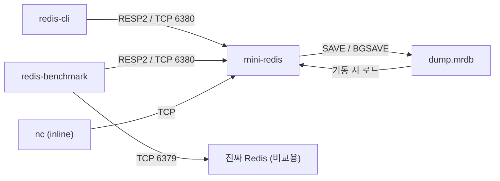

# mini-redis 소프트웨어 요구사항 명세서 (SRS)

| 문서 | 버전 | 작성일 | 기준 표준 |
|------|------|--------|-----------|
| mini-redis SRS | 1.0 | 2026-11-18 | ISO/IEC/IEEE 29148:2018 |

## 1. 소개

### 1.1 목적

이 문서는 mini-redis의 요구사항을 정의한다. mini-redis는 C로 만든 macOS용 단일 노드 Redis 호환 서버다. 진짜 `redis-cli`와 `redis-benchmark`가 그대로 접속해 동작하고, 같은 조건에서 진짜 Redis와 성능을 비교해 기록하는 것이 완료 조건이다. 설계는 [SDS](SDS.md)에서 다룬다.

### 1.2 범위

mini-redis가 하는 일은 다음과 같다. 하지 않는 일은 [부록 B](#부록-b-범위-외-항목)에 있다.

- RESP2 프로토콜 처리 (multibulk와 inline, incremental 파싱)
- kqueue 기반 단일 스레드 이벤트 루프, 논블로킹 소켓
- 자료구조: string, list, hash, set
- 명령 30개: PING, ECHO, GET, SET, DEL, EXISTS, INCR, DBSIZE, FLUSHALL, LPUSH, RPUSH, LPOP, RPOP, LRANGE, LLEN, HSET, HGET, HDEL, HGETALL, SADD, SREM, SISMEMBER, SMEMBERS, SCARD, EXPIRE, TTL, PERSIST, CONFIG (GET/SET maxmemory), SAVE, BGSAVE
- TTL 만료: 지연 삭제 + 주기 샘플링
- maxmemory + LRU 근사 eviction (allkeys-lru만)
- RDB 스냅샷: fork + COW, 자체 바이너리 포맷 `dump.mrdb`, 기동 시 로드
- `redis-benchmark` 비교 측정과 `BENCH.md` 기록

### 1.3 제품 개요

#### 1.3.1 제품 관점

mini-redis는 독립 실행 서버 프로세스다. 클라이언트는 TCP로 접속하고, 서버는 현재 디렉터리의 스냅샷 파일을 읽고 쓴다. 진짜 Redis는 벤치마크 비교 대상으로만 쓰인다.

#### 1.3.2 제품 기능

- 다수 클라이언트의 요청을 스레드 하나로 받아 요청 순서대로 실행하고 응답한다
- string, list, hash, set 값을 키 하나에 저장하고 조회한다
- 키에 만료 시각을 걸고, 지난 키를 접근 시점과 주기 작업 두 경로로 지운다
- 메모리 상한을 넘으면 오래 쓰지 않은 키를 지우고, 더 지울 수 없으면 쓰기를 거부한다
- 전체 데이터를 파일로 저장하고, 기동 시 복원한다. 백그라운드 저장 중에도 요청을 받는다

#### 1.3.3 사용자 특성

| 사용자 | 특성 |
|--------|------|
| 학습자 / 개발자 | Redis 명령과 `redis-cli` 사용법을 안다. 이벤트 루프, TTL/LRU, fork 기반 영속화 동작을 직접 확인하려 한다 |
| 클라이언트 도구 | `redis-cli`, `redis-benchmark`. RESP2 multibulk로 요청을 보내고, `redis-benchmark`의 PING_INLINE 테스트는 inline 형식을 쓴다 |

#### 1.3.4 제한 사항

| 항목 | 내용 |
|------|------|
| 언어 | C11 (`cc -std=c11 -Wall -Wextra -O2`) |
| 플랫폼 | macOS 전용. 멀티플렉싱은 kqueue, 메모리 추적은 `malloc_size()` (`<malloc/malloc.h>`) |
| 의존성 | 외부 라이브러리 없음. libc와 시스템 콜만 사용 |
| 스레딩 | 단일 스레드 이벤트 루프. `BGSAVE`용 fork 자식 프로세스만 예외 |
| 빌드 | `make` (산출물 `mini-redis`) |
| 테스트 환경 | `redis-cli`, `nc` 필요 (`make test`) |
| 벤치 환경 | `redis-benchmark`, `redis-server` 필요 (`bench/run_bench.sh`). 대체 부하 도구 `bench/loadgen.py`는 `python3` 필요 |

### 1.4 용어 정의

| 용어 | 뜻 |
|------|----|
| RESP2 | Redis 클라이언트-서버 통신 형식 (버전 2). 요청은 배열, 응답은 5가지 타입 |
| multibulk | `*<개수>\r\n$<길이>\r\n<바이트>\r\n...` 형태의 배열 요청. `redis-cli`가 보내는 기본 형식 |
| inline 명령 | `PING\r\n`처럼 공백으로 인자를 나눈 한 줄 평문 요청 (telnet식) |
| kqueue | macOS에서 여러 파일 디스크립터(fd)의 읽기/쓰기 가능 여부를 한 번에 감시하는 시스템 콜 |
| 논블로킹 소켓 | 데이터가 없으면 기다리지 않고 즉시 `EAGAIN`을 반환하는 소켓 |
| 부분 수신 | 요청 하나가 여러 번의 `read()`로 나뉘어 도착하는 상황 |
| 파이프라이닝 | 클라이언트가 응답을 기다리지 않고 여러 요청을 연달아 보내는 방식 |
| TTL | 키의 남은 수명. `EXPIRE`로 설정한다 |
| 지연 삭제 (lazy expiry) | 키에 접근할 때 만료 여부를 검사해 그 자리에서 지우는 방식 |
| 주기 샘플링 (active expiry) | 타이머마다 만료 테이블에서 무작위로 키를 뽑아 만료분을 지우는 방식 |
| maxmemory | 서버가 쓸 수 있는 근사 메모리 상한 (바이트). 0은 무제한 |
| eviction | 메모리 상한을 넘을 때 기존 키를 지워 공간을 확보하는 동작 |
| LRU 근사 | 무작위 샘플 중 가장 오래 접근되지 않은 키를 고르는 방식 (Least Recently Used의 근사) |
| RDB 스냅샷 | 전체 키스페이스를 파일 하나에 저장한 것. 이 프로젝트는 자체 포맷 `dump.mrdb`를 쓴다 |
| fork / COW | `fork()`로 만든 자식 프로세스가 부모 메모리를 공유하다가 바뀐 페이지만 복사하는 방식 (copy-on-write) |
| WRONGTYPE | 키에 저장된 값의 타입과 명령이 맞지 않을 때의 오류 |
| OOM | 메모리 상한 때문에 쓰기를 거부할 때의 오류 (out of memory) |

## 2. 참고 문서

| 문서 | 내용 |
|------|------|
| [SDS.md](SDS.md) | 설계 명세: 구성, 자료구조, 파일/통신 포맷, 시퀀스, 알고리즘 |
| [README.md](../README.md) | 프로젝트 소개, 빠른 시작, 벤치마크 요약 |
| [BENCH.md](../BENCH.md) | 벤치마크 측정 조건, 전체 수치, 해석 |
| [.planning/SPEC.md](../.planning/SPEC.md) | 원본 요구사항 (R1-R7)과 수용 기준 |
| [tests/run.sh](../tests/run.sh) | end-to-end 테스트 |
| [bench/run_bench.sh](../bench/run_bench.sh) | 진짜 Redis와 나란히 측정하는 벤치 스크립트 |

## 3. 요구사항

### 3.1 기능 요구사항

#### FR-1 RESP 서버와 이벤트 루프

| 설명 | 우선순위 | 출처 | 검증 방법 |
|------|----------|------|-----------|
| 서버는 kqueue 단일 스레드 이벤트 루프 위에서 RESP2 요청을 incremental 파싱해 다수 클라이언트를 처리해야 한다 | 필수 | SPEC R1 | 시험 |

수용 기준:

- `PING`이 `PONG`을, `PING <msg>`가 `<msg>`를 반환한다
- `ECHO hello`가 `hello`를 반환한다
- 클라이언트 여러 개가 동시에 접속해도 각각 명령이 정상 동작한다
- 요청 하나가 여러 `read()`로 나뉘어 도착해도 정상 파싱한다 (부분 수신)
- 한 번에 몰려 온 여러 요청을 요청 순서대로 실행하고 응답한다 (파이프라이닝)
- `*`로 시작하지 않는 입력은 inline 명령으로 파싱한다
- 형식이 잘못된 multibulk 요청에는 `-ERR Protocol error` 응답 후 연결을 닫는다
- 미지원 명령에는 `-ERR unknown command '<이름>'`을 반환하고 연결은 유지한다
- 클라이언트가 갑자기 끊겨도(EOF/RST) fd와 버퍼가 누수 없이 정리된다
- `--port N` 또는 `-p N`으로 포트를 지정할 수 있고 기본값은 6380이다

#### FR-2 string 키스페이스

| 설명 | 우선순위 | 출처 | 검증 방법 |
|------|----------|------|-----------|
| 서버는 해시테이블 키스페이스 위에서 string 명령을 진짜 Redis와 같은 응답 형식으로 처리해야 한다 | 필수 | SPEC R2 | 시험 |

수용 기준:

- `SET k v` 후 `GET k`가 `v`를, 없는 키의 `GET`은 nil을 반환한다
- `DEL`이 삭제된 키 개수를, `EXISTS`가 존재하는 키 개수를 반환한다
- `INCR`이 정수 값을 1 올리고, 정수가 아닌 값에는 `-ERR value is not an integer or out of range`를 반환한다
- 1MB 값의 `SET`/`GET` 왕복이 성공한다
- `DBSIZE`가 키 개수를 반환하고 `FLUSHALL`이 전체 키를 지운다

#### FR-3 컬렉션 자료구조

| 설명 | 우선순위 | 출처 | 검증 방법 |
|------|----------|------|-----------|
| 서버는 list, hash, set 타입 명령을 처리하고, 타입이 맞지 않으면 WRONGTYPE 오류를 내야 한다 | 필수 | SPEC R3 | 시험 |

수용 기준:

- `RPUSH` 후 `LRANGE 0 -1`이 넣은 순서대로 전체를 반환하고 `LLEN`이 길이를 반환한다
- `LPUSH`는 머리에 넣어 `LRANGE`에서 역순으로 보인다
- `LPOP`이 머리 요소를 꺼낸다
- `RPOP`이 꼬리 요소를 꺼내고, 리스트가 비면 키가 삭제된다
- `HSET`/`HGET`/`HGETALL`이 필드 단위로 동작한다
- `HDEL`이 필드를 지우고, hash가 비면 키가 삭제된다
- `SADD`가 중복을 무시하고 `SISMEMBER`/`SCARD`가 정확하다
- `SREM`/`SMEMBERS`가 동작하고, set이 비면 키가 삭제된다
- 다른 타입의 키에 명령을 쓰면 `-WRONGTYPE` 오류를 반환한다
- `SET`은 기존 키의 타입과 무관하게 string으로 덮어쓴다

#### FR-4 TTL - 지연 삭제와 주기 샘플링

| 설명 | 우선순위 | 출처 | 검증 방법 |
|------|----------|------|-----------|
| 서버는 `EXPIRE`로 설정한 만료를 지연 삭제와 주기 샘플링 두 경로로 처리해야 한다 | 필수 | SPEC R4 | 시험 |

수용 기준:

- `EXPIRE k 1` 후 1초가 지나면 `GET k`가 nil을 반환한다 (지연 삭제)
- `TTL`이 만료 없는 키에 -1, 없는 키에 -2를 반환한다
- `TTL`이 만료가 있는 키에 남은 초(올림)를 반환한다
- `PERSIST`가 만료를 제거해 `TTL`이 -1이 된다
- `EXPIRE`에 0 이하를 주면 키를 즉시 삭제하고 1을 반환한다
- 만료된 키에 접근이 없어도 주기 샘플링이 지워 `DBSIZE`가 줄어든다
- 만료 시각이 지난 키는 어떤 명령에서도 값으로 보이지 않는다

#### FR-5 maxmemory와 LRU 근사 eviction

| 설명 | 우선순위 | 출처 | 검증 방법 |
|------|----------|------|-----------|
| 서버는 근사 할당량이 maxmemory를 넘으면 무작위 샘플 중 가장 오래 접근되지 않은 키를 지우고, 공간을 확보할 수 없으면 쓰기에 `-OOM`을 반환해야 한다 | 필수 | SPEC R5 | 시험 |

수용 기준:

- `CONFIG GET maxmemory`가 현재 값을, `CONFIG SET maxmemory <bytes>`가 값을 바꾼다 (`kb`, `mb`, `gb` 등 단위 허용)
- maxmemory를 넘는 쓰기에서 기존 키가 evict되고 새 쓰기가 성공한다
- 최근 접근한 키보다 오래 접근되지 않은 키가 먼저 evict되는 경향을 보인다
- evict로 공간을 확보할 수 없으면 쓰기에 `-OOM command not allowed when used memory > 'maxmemory'`를 반환하고 서버는 계속 동작한다
- maxmemory가 0(기본값)이면 eviction이 일어나지 않는다

#### FR-6 RDB 스냅샷 - fork와 COW

| 설명 | 우선순위 | 출처 | 검증 방법 |
|------|----------|------|-----------|
| 서버는 `SAVE`/`BGSAVE`로 전체 키스페이스를 자체 바이너리 포맷 파일 `dump.mrdb`에 저장하고, 기동 시 이 파일을 읽어야 한다 | 필수 | SPEC R6 | 시험 |

수용 기준:

- `SAVE` 후 재시작하면 string/list/hash/set 데이터가 모두 복원된다
- `BGSAVE`가 즉시 `+Background saving started`를 반환하고 저장 중에도 쓰기가 성공한다
- `BGSAVE` 중에 새로 쓴 키는 그 스냅샷에 없어도 된다 (fork 시점 일관성)
- 만료 시각이 저장되고, 로드 시점에 이미 만료된 키는 복원되지 않는다
- 손상되거나 잘린 파일로 기동하면 에러 로그 후 종료 코드 1로 기동을 거부한다 (segfault 아님)
- 파일이 없으면 빈 DB로 정상 기동한다
- 이미 `BGSAVE`가 진행 중이면 `-ERR Background save already in progress`를 반환한다
- fork 실패나 디스크 오류가 서버 크래시로 이어지지 않는다 (오류 응답 또는 로그 후 계속 동작)

#### FR-7 벤치마크 비교 기록

| 설명 | 우선순위 | 출처 | 검증 방법 |
|------|----------|------|-----------|
| `redis-benchmark`로 mini-redis와 진짜 Redis를 같은 머신, 같은 옵션에서 측정한 수치가 `BENCH.md`에 기록되어야 한다 | 필수 | SPEC R7 | 시연, 검사 |

수용 기준:

- `redis-benchmark -p 6380 -t ping,set,get,incr,lpush,lpop,sadd,hset -n 100000`이 오류 없이 완주한다
- 파이프라이닝 조건(`-P 16`)에서도 완주한다
- 진짜 Redis를 같은 옵션, 영속화 끈 상태로 측정한 수치가 측정 조건과 함께 나란히 기록된다
- 차이가 어디서 오는지 추정한 해석이 포함된다

### 3.2 성능 요구사항

| ID | 요구사항 | 목표치 | 검증 방법 |
|----|----------|--------|-----------|
| NFR-1 | 진짜 Redis와 같은 조건에서 처리량을 비교한다. 절대 목표치는 없다 | 같은 머신, 같은 `-n`/`-c`/`-P`, 진짜 Redis 영속화 OFF, 3회 측정 중앙값 기록 | 검사 (`BENCH.md`) |
| NFR-2 | 주기 샘플링이 이벤트 루프를 오래 막지 않는다 | 100ms마다 샘플 20개, 반복은 최대 16회 및 25ms 이내 | 검사 (코드) |
| NFR-3 | 응답을 쓰기 버퍼에 모아 한 번에 `write()` 하고, 소켓이 가득 차면 나중에 이어 쓴다 | `EAGAIN` 시 `EVFILT_WRITE` 등록 후 재개 | 시연 (`BENCH.md` `-P 16` 완주) |

### 3.3 사용성 요구사항

| ID | 요구사항 |
|----|----------|
| NFR-4 | 오류 응답은 진짜 Redis와 같은 접두어(`ERR`, `WRONGTYPE`, `OOM`)와 문구를 써서 `redis-cli`가 `(error)`로 표시한다 |
| NFR-5 | 명령 이름은 대소문자를 구분하지 않는다 |

### 3.4 인터페이스 요구사항

| 종류 | 인터페이스 | 요구사항 |
|------|------------|----------|
| 사용자 | 명령행 `./mini-redis [--port N \| -p N]` | 포트 범위 1-65535. 잘못된 인자는 에러 메시지 후 종료 코드 1 |
| 사용자 | 표준 에러 로그 | 기동 포트, 로드한 키 개수, 손상 스냅샷, `BGSAVE` 결과를 출력한다 |
| 소프트웨어 | libc, BSD 소켓, kqueue, `fork`/`waitpid` | 외부 라이브러리 없이 이것만 사용한다 |
| 소프트웨어 | 파일 `dump.mrdb` | 현재 디렉터리에 자체 바이너리 포맷으로 읽고 쓴다 |
| 통신 | TCP, 모든 IPv4 주소(`INADDR_ANY`), 기본 포트 6380 | 진짜 Redis 기본 포트 6379와 겹치지 않는다 |
| 통신 | RESP2 | multibulk와 inline 요청, `+` `-` `:` `$` `*` 응답 타입 |

### 3.5 논리 데이터 요구사항

| 데이터 | 보존 요구 |
|--------|-----------|
| 키스페이스 | 키(이진 안전 바이트열) 하나에 string, list, hash, set 중 한 값을 저장한다 |
| 만료 시각 | 만료가 있는 키마다 절대 시각(ms)을 저장한다 |
| 접근 시각 | 값 객체마다 마지막 접근 시각(ms)을 저장해 eviction에 쓴다 |
| 메모리 사용량 | 서버 전체의 근사 할당 바이트 수를 유지한다 |
| 스냅샷 | 모든 키, 값, 만료 시각을 파일에 저장한다. 저장 시점에 이미 만료된 키는 뺀다. 접근 시각은 저장하지 않는다 |

자료구조와 바이트 배치는 [SDS 3.4 정보 뷰](SDS.md#34-정보-뷰)에 있다.

### 3.6 설계 제약

- C11, 외부 라이브러리 금지 (libc와 시스템 콜만)
- macOS 전용, 멀티플렉싱은 kqueue
- 단일 스레드 이벤트 루프 (`BGSAVE` fork 자식만 예외)
- 스냅샷은 자체 포맷이며 진짜 RDB 포맷과 호환하지 않는다
- 해시테이블 리사이즈는 일괄 방식 (incremental rehash 없음)
- eviction 정책은 allkeys-lru 근사 하나
- 메모리 판정은 RSS가 아닌 malloc 래퍼 기반 근사

### 3.7 소프트웨어 시스템 속성

| ID | 속성 | 요구사항 | 목표치 |
|----|------|----------|--------|
| NFR-6 | 신뢰성 | 저장 중 실패해도 기존 스냅샷이 깨지지 않는다 | 임시 파일에 쓴 뒤 `rename()`으로 원자 교체 |
| NFR-7 | 신뢰성 | 손상된 스냅샷을 빈 DB로 조용히 대체하지 않는다 | 매직, 버전, 길이, 체크섬 검사 실패 시 종료 코드 1 |
| NFR-8 | 신뢰성 | 끊긴 소켓에 쓰기를 해도 프로세스가 죽지 않는다 | `SIGPIPE` 무시, 쓰기 오류는 연결 종료로 처리 |
| NFR-9 | 신뢰성 | 끝난 `BGSAVE` 자식이 좀비로 남지 않는다 | 이벤트 루프 매 반복마다 `waitpid(WNOHANG)`으로 회수 |
| NFR-10 | 가용성 | `BGSAVE` 중에도 요청을 계속 처리한다 | 부모는 fork 직후 응답하고 이벤트 루프로 복귀 |
| NFR-11 | 보안 | 비정상적으로 큰 입력으로 메모리를 소진시키지 못한다 | 인자 개수 1,048,576개, bulk 512MB, inline 한 줄 64KiB, 헤더 줄 64바이트 상한. 스냅샷 길이 필드 512MB 상한 |
| NFR-12 | 유지보수성 | 명령 추가가 한 곳에서 끝난다 | 이름, 핸들러, arity, 메모리 증가 여부를 담은 명령 테이블 하나 |
| NFR-13 | 유지보수성 | 메모리 사용량을 RSS가 아닌 할당 추적으로 근사한다 | 모든 할당이 `zmalloc` 래퍼를 지나며 `malloc_size()` 합계를 유지. 바이트 정확도는 요구하지 않음 |
| NFR-14 | 유지보수성 | 큰 요청 하나가 버퍼 메모리를 계속 점유하지 않는다 | 다 비운 읽기/쓰기 버퍼가 64KiB를 넘으면 해제 |
| NFR-15 | 이식성 | macOS에서만 빌드하고 동작한다 | kqueue, `malloc_size()` 의존 |

### 3.8 금지 조건 (must-NOT)

- 파이프라인 응답 순서가 요청 순서와 달라지지 않는다
- 만료 시각이 지난 키가 `GET`에서 값을 반환하지 않는다
- maxmemory가 0일 때 eviction이 발동하지 않는다
- `BGSAVE` 실패(fork 실패, 디스크 오류)가 서버 크래시로 이어지지 않는다
- 손상된 스냅샷을 빈 DB로 조용히 대체해 데이터 유실을 가리지 않는다
- `BGSAVE` 자식 프로세스는 상속받은 클라이언트 소켓에 응답하지 않는다

## 4. 검증

### 4.1 검증 방법

| 방법 | 도구 | 다루는 것 | 실행 |
|------|------|-----------|------|
| 시험 | `tests/run.sh` | 실제 서버를 빈 임시 디렉터리와 포트 6399(`MINIREDIS_TEST_PORT`로 변경)에 띄우고 공식 `redis-cli`와 `nc`로 응답을 검사한다. 프로토콜(inline 포함), string, list/hash/set, TTL, 동시 접속 20개, 파이프라이닝. 현재 결과 33 passed, 0 failed | `make test` |
| 시연 | `bench/run_bench.sh` | mini-redis(6380)와 진짜 Redis(6379, 영속화 OFF)를 같은 `redis-benchmark` 옵션으로 측정한다 | `bash bench/run_bench.sh` |
| 시연 | `bench/loadgen.py` | `redis-benchmark`가 없을 때 mini-redis 단독 부하를 걸어 완주 여부와 처리량을 본다. 비교 근거로는 쓰지 않는다 | `python3 bench/loadgen.py` |
| 검사 | `BENCH.md`, 소스 코드 | 측정 조건과 수치, 상한 값과 알고리즘 상수 | 문서/코드 확인 |

FR-5 (eviction)와 FR-6 (스냅샷)은 자동 테스트가 없어 대부분 미검증이다.

### 4.2 요구사항 추적표

| ID | 요구사항 | 구현 위치 | 검증 근거 | 상태 |
|----|----------|-----------|-----------|------|
| FR-1.1 | PING / PING msg | `src/command.c` | `tests/run.sh` "PING -> PONG", "PING msg echoes" | 충족 |
| FR-1.2 | ECHO | `src/command.c` | `tests/run.sh` "ECHO hello" | 충족 |
| FR-1.3 | 동시 다중 클라이언트 | `src/server.c` | `tests/run.sh` "20 concurrent INCR -> 20" | 충족 |
| FR-1.4 | 부분 수신 파싱 | `src/resp.c`, `src/server.c` | `tests/run.sh` "1MB bulk round-trip len" (1MB 요청은 16KiB 단위 `read()` 여러 번으로 수신) | 충족 |
| FR-1.5 | 파이프라이닝 순서 | `src/server.c` (`process_input`) | `tests/run.sh` "pipelined SET/INCR/GET replies present" (INCR 결과 `:2`로 실행 순서 확인), `BENCH.md` `-P 16` 완주 | 충족 |
| FR-1.6 | inline 명령 | `src/resp.c` (`resp_parse_inline`) | `tests/run.sh` "inline PING -> +PONG", `BENCH.md` PING_INLINE | 충족 |
| FR-1.7 | 잘못된 multibulk -> Protocol error 후 종료 | `src/resp.c`, `src/server.c` | 자동 테스트 없음 | 미검증 |
| FR-1.8 | 미지원 명령 오류, 연결 유지 | `src/command.c` (`command_dispatch`) | `tests/run.sh` "unknown cmd -> error, conn stays open"은 별도 연결로 서버 생존만 확인. 오류 문구와 같은 연결 유지는 미확인 | 미검증 |
| FR-1.9 | 급단절 시 fd/버퍼 정리 | `src/server.c` (`close_client`), `src/conn.c` | 자동 테스트 없음 | 미검증 |
| FR-1.10 | `--port` / `-p` 옵션 | `src/server.c` (`parse_args`) | `tests/run.sh`가 `--port 6399`로 서버를 띄움 | 충족 |
| FR-2.1 | SET / GET / 없는 키 nil | `src/command.c`, `src/db.c` | `tests/run.sh` "SET k v", "GET k", "GET missing" | 충족 |
| FR-2.2 | DEL / EXISTS 개수 | `src/command.c` | `tests/run.sh` "EXISTS k -> 1", "DEL k -> 1" | 충족 |
| FR-2.3 | INCR와 비정수 오류 | `src/command.c` (`incr_cmd`) | `tests/run.sh` "INCR n -> 11", "INCR non-int -> error" | 충족 |
| FR-2.4 | 1MB 값 왕복 | `src/resp.c`, `src/conn.c` | `tests/run.sh` "1MB bulk round-trip len" | 충족 |
| FR-2.5 | DBSIZE / FLUSHALL | `src/command.c`, `src/db.c` | 자동 테스트 없음 | 미검증 |
| FR-3.1 | RPUSH + LRANGE 순서, LLEN | `src/command.c`, `src/list.c` | `tests/run.sh` "RPUSH l a b c", "LLEN l", "LRANGE l 0 -1" | 충족 |
| FR-3.2 | LPUSH 머리 삽입 | `src/command.c`, `src/list.c` | 자동 테스트 없음 | 미검증 |
| FR-3.3 | LPOP | `src/command.c`, `src/list.c` | `tests/run.sh` "LPOP l -> a" | 충족 |
| FR-3.4 | RPOP, 빈 리스트 키 삭제 | `src/command.c` (`pop_cmd`) | 자동 테스트 없음 | 미검증 |
| FR-3.5 | HSET / HGET / HGETALL | `src/command.c`, `src/dict.c` | `tests/run.sh` "HSET h f1 v1", "HGET h f1", "HGETALL h fields (sorted)" | 충족 |
| FR-3.6 | HDEL, 빈 hash 키 삭제 | `src/command.c` (`hdel_cmd`) | 자동 테스트 없음 | 미검증 |
| FR-3.7 | SADD 중복 무시, SISMEMBER, SCARD | `src/command.c`, `src/dict.c` | `tests/run.sh` "SADD s x y y -> 2", "SISMEMBER s x", "SCARD s" | 충족 |
| FR-3.8 | SREM / SMEMBERS, 빈 set 키 삭제 | `src/command.c` | 자동 테스트 없음 | 미검증 |
| FR-3.9 | WRONGTYPE | `src/command.c` | `tests/run.sh` "WRONGTYPE: GET on list" | 충족 |
| FR-3.10 | SET이 다른 타입을 덮어씀 | `src/command.c` (`set_cmd`), `src/db.c` | 자동 테스트 없음 | 미검증 |
| FR-4.1 | 지연 삭제 | `src/db.c` (`lookup`) | `tests/run.sh` "lazy expire: GET after TTL -> nil" | 충족 |
| FR-4.2 | TTL -1 / -2 | `src/command.c` (`ttl_cmd`) | `tests/run.sh` "TTL no-expiry -> -1", "TTL missing -> -2" | 충족 |
| FR-4.3 | TTL 남은 초 | `src/command.c` (`ttl_cmd`) | 자동 테스트 없음 | 미검증 |
| FR-4.4 | PERSIST | `src/command.c`, `src/db.c` | `tests/run.sh` "PERSIST -> 1", "TTL after PERSIST -> -1" | 충족 |
| FR-4.5 | EXPIRE 0 이하 즉시 삭제 | `src/command.c` (`expire_cmd`) | `tests/run.sh` "EXPIRE <=0 deletes now -> 1", "t3 gone after EXPIRE 0" (0으로 검증. 음수는 같은 `secs <= 0` 분기) | 충족 |
| FR-4.6 | 주기 샘플링 | `src/server.c` (`active_expire_cycle`) | 자동 테스트 없음 | 미검증 |
| FR-4.7 | 만료 키가 값으로 보이지 않음 | `src/db.c` (`lookup` 단일 경로) | `tests/run.sh` "lazy expire: GET after TTL -> nil" (단일 시나리오) | 충족 |
| FR-5.1 | CONFIG GET/SET maxmemory | `src/command.c` (`config_cmd`), `src/util.c` (`parse_memory`) | 자동 테스트 없음 | 미검증 |
| FR-5.2 | 초과 쓰기 시 evict 후 성공 | `src/command.c` (`check_oom`, `evict_until`) | 자동 테스트 없음 | 미검증 |
| FR-5.3 | LRU 경향 | `src/command.c` (`evict_until`), `src/db.c` | 자동 테스트 없음 | 미검증 |
| FR-5.4 | 확보 불가 시 -OOM, 서버 생존 | `src/command.c` (`check_oom`) | 자동 테스트 없음 | 미검증 |
| FR-5.5 | maxmemory 0이면 eviction 없음 | `src/command.c` (`check_oom`) | 자동 테스트 없음 | 미검증 |
| FR-6.1 | SAVE 후 재시작 복원 | `src/rdb.c`, `src/server.c` (`main`) | 자동 테스트 없음 | 미검증 |
| FR-6.2 | BGSAVE 즉시 응답, 저장 중 쓰기 | `src/server.c` (`server_start_bgsave`), `src/command.c` | 자동 테스트 없음 | 미검증 |
| FR-6.3 | fork 시점 일관성 | `src/server.c` (`server_start_bgsave`) | 자동 테스트 없음 | 미검증 |
| FR-6.4 | 만료 시각 저장, 만료 키 미복원 | `src/rdb.c` | 자동 테스트 없음 | 미검증 |
| FR-6.5 | 손상 파일 기동 거부 | `src/rdb.c` (`rdb_load`), `src/server.c` (`main`) | 자동 테스트 없음 | 미검증 |
| FR-6.6 | 파일 없으면 빈 DB 기동 | `src/rdb.c` (`RDB_NOFILE`), `src/server.c` | `tests/run.sh`가 빈 임시 디렉터리에서 서버를 띄우고 PING 준비 확인 | 충족 |
| FR-6.7 | BGSAVE 중복 실행 거부 | `src/server.c`, `src/command.c` (`bgsave_cmd`) | 자동 테스트 없음 | 미검증 |
| FR-6.8 | fork/디스크 오류에 크래시 없음 | `src/server.c`, `src/command.c`, `src/rdb.c` | 자동 테스트 없음 | 미검증 |
| FR-7.1 | `-P 1` 완주 | `src/*` | `BENCH.md` 결과 표 (`-P1` 열) | 충족 |
| FR-7.2 | `-P 16` 완주 | `src/*` | `BENCH.md` 결과 표 (`-P16` 열) | 충족 |
| FR-7.3 | 진짜 Redis 나란히 기록, 조건 명시 | `bench/run_bench.sh` | `BENCH.md` "측정 조건", "결과 표" | 충족 |
| FR-7.4 | 차이 원인 해석 | `BENCH.md` | `BENCH.md` "해석" | 충족 |
| NFR-1 | 같은 조건 비교 기록 | `bench/run_bench.sh` | `BENCH.md` "측정 조건" (3회 중앙값) | 충족 |
| NFR-2 | 주기 샘플링 시간 상한 | `src/server.c` (`active_expire_cycle`) | 코드 검사만 (측정 없음) | 미검증 |
| NFR-3 | 쓰기 백프레셔 | `src/server.c` (`flush_write`, `el_set_write`) | `BENCH.md` `-P 16` 완주 | 충족 |
| NFR-4 | Redis 형식 오류 응답 | `src/command.c`, `src/resp.c` | `tests/run.sh` "INCR non-int -> error", "WRONGTYPE: GET on list" | 충족 |
| NFR-5 | 명령 대소문자 무시 | `src/command.c` (`lookup_command`) | 자동 테스트 없음 | 미검증 |
| NFR-6 | 스냅샷 원자 교체 | `src/rdb.c` (`rdb_save`) | 자동 테스트 없음 | 미검증 |
| NFR-7 | 손상 스냅샷 기동 거부 | `src/rdb.c`, `src/server.c` | 자동 테스트 없음 | 미검증 |
| NFR-8 | SIGPIPE 무시 | `src/server.c` (`main`) | 자동 테스트 없음 | 미검증 |
| NFR-9 | 자식 좀비 회수 | `src/server.c` (`reap_bgsave`) | 자동 테스트 없음 | 미검증 |
| NFR-10 | BGSAVE 중 서비스 지속 | `src/server.c` (`server_start_bgsave`) | 자동 테스트 없음 | 미검증 |
| NFR-11 | 입력 크기 상한 | `src/resp.c`, `src/rdb.c` | 자동 테스트 없음 | 미검증 |
| NFR-12 | 명령 테이블 | `src/command.c` (`command_table`) | 코드 검사 | 충족 |
| NFR-13 | zmalloc 할당 추적 | `src/zmalloc.c` | 자동 테스트 없음 | 미검증 |
| NFR-14 | 큰 버퍼 해제 | `src/server.c` (`read_from_client`, `flush_write`) | 자동 테스트 없음 | 미검증 |
| NFR-15 | macOS 전용 | `src/server.c`, `src/zmalloc.c` | `BENCH.md` 측정 환경 (macOS 26.5.1)에서 빌드와 측정 | 충족 |

## 부록 A. 가정과 의존성

- 테스트 머신에 `redis-cli`와 `nc`가 있다. 벤치 머신에는 `redis-benchmark`, `redis-server`가 추가로 있다
- 서버는 로컬 학습용으로 신뢰할 수 있는 네트워크에서만 쓴다 (인증 없음)
- 서버를 실행한 현재 디렉터리에 쓰기 권한이 있어야 `SAVE`/`BGSAVE`가 성공한다
- 만료 시각과 접근 시각은 벽시계(`gettimeofday`) 기준 ms다. 시스템 시각이 바뀌면 만료 판정도 따라 바뀐다
- 데이터베이스는 하나뿐이다 (SELECT 없음)

## 부록 B. 범위 외 항목

| 항목 | 이유 |
|------|------|
| AOF 영속화 | RDB만으로 fork + COW 영속화 개념을 다룰 수 있다 |
| pub/sub | 키스페이스 동작과 별개인 기능이다 |
| 복제, 클러스터, Sentinel | 단일 노드 범위를 넘는다 |
| RESP3, HELLO | `redis-cli`는 RESP2로 동작한다 |
| MULTI/EXEC 트랜잭션, Lua 스크립팅 | 이 프로젝트의 목표와 무관하다 |
| 진짜 RDB 파일 포맷 호환 | 자체 포맷으로 충분하다 |
| incremental rehash | 해시테이블 리사이즈는 일괄 방식으로 단순화했다 |
| volatile-lru 등 다른 eviction 정책 | allkeys-lru 하나로 개념을 다룰 수 있다 |
| KEYS 글롭 패턴 매칭 | 키 개수 확인은 DBSIZE로 대신한다 |
| TLS, ACL, 인증 | 로컬 전용 서버다 |
